# UI/UX Bug Fixes, Dynamic Evidence Reset, and Context-Aware Probing Implementation Report

This report documents the architectural design, user experience enhancements, formal statutory synthesis, and test verification results for the Conversational V2 release in [`web/src/components/wizard/SautiWizard.tsx`](file:///C:/Users/Violet/Desktop/github projects/SautiyaDere/web/src/components/wizard/SautiWizard.tsx), [`web/src/utils/pdfGenerator.js`](file:///C:/Users/Violet/Desktop/github projects/SautiyaDere/web/src/utils/pdfGenerator.js), and [`web/src/db/db.js`](file:///C:/Users/Violet/Desktop/github projects/SautiyaDere/web/src/db/db.js).

---

## 1. Executive Summary

- **Primary Components**:
  - [`web/src/components/wizard/SautiWizard.tsx`](file:///C:/Users/Violet/Desktop/github projects/SautiyaDere/web/src/components/wizard/SautiWizard.tsx) (Intake wizard, context-aware probing, true fact binding, dynamic evidence checklist, and drawer actions)
  - [`web/src/utils/pdfGenerator.js`](file:///C:/Users/Violet/Desktop/github projects/SautiyaDere/web/src/utils/pdfGenerator.js) (Formal appeal statement synthesis & 1-page A4 PDF rendering)
  - [`web/src/db/db.js`](file:///C:/Users/Violet/Desktop/github projects/SautiyaDere/web/src/db/db.js) (On-device Dexie.js storage & complete local privacy purge)
- **Key Enhancements**:
  1. **Dynamic Initial State & Clean Reset**: `evidenceHeld` initializes strictly as empty `[]`. Readiness starts at `0% (Low)`. Items are only marked "Added" when explicitly attached or ticked. Resetting a case (`startNewCase`) resets all state to clean defaults.
  2. **Context-Aware Probing & Short Input Guard (Screen 3)**: Dynamically adapts guidance prompts and placeholders to the selected dispute category (`noticeText`). Blocks inputs under 20 characters with a clear warning: *"⚠️ Tafadhali share a bit more detail about the trip so DereBot can extract facts and build your appeal."*
  3. **True Fact Binding & Backward Navigation Loop (Screen 4)**: Binds `analysis.entities` directly from `/api/analyze`. When zero facts are detected, prompts the driver and provides a primary button: `"← Go Back & Add Trip Details"`, preserving typed text. Manual `+ Add Fact` entries persist directly into the appeal dossier.
  4. **Formal Appeal Synthesis (Screen 6 & PDF)**: Professional 5-part statutory statement:
     - Addressee: `[Platform] Driver Appeals & Partner Operations`
     - Formal Notice: Citing NTSA Legal Notice 120 (Reg 15) and Kenya Data Protection Act 2019 (Sec 26).
     - Case Facts: Itemizing incident date, operating hours, route, and platform ticket ref.
     - Rebuttal: Synthesizing the driver's defense cleanly without wrapping raw text in quotes.
     - Demand: Reinstatement request within the 30-day statutory window.
  5. **Mobile Drawer & Privacy Data Purge**: Configured `z-50` for mobile overlay, added `"Privacy & Clear Local Data"` executing `db.profile.clear()` and `db.cases.clear()`, clearing `localStorage`, resetting state, and redirecting to Screen 0 with an alert confirmation. Bound `"Forward to TAWU-Kenya"` to a formatted `mailto:` link and `"Call TAWU Hotline"` to `tel:+254700000000`.
- **Verification**: `npm run build` compiled cleanly (`0 errors`), and `npm test` verified all **7/7 tests passed**.

---

## 2. Technical Architecture & Component Flow

```mermaid
flowchart TD
    subgraph S3["Screen 3: Chat & Context-Aware Probing"]
        Cat["Selected Dispute Category (noticeText)"] --> Probing["getContextProbing(noticeText)<br/>• Safety: route + passenger interaction<br/>• Fare: route + fare amount + M-Pesa<br/>• Rating: dates + pickup + cancellation reason<br/>• Vague: trip date + time + summary"]
        Input["Driver Input (<textarea>)"] --> Guard{"Length >= 20 chars?"}
        Guard -- "No" --> Warn["Show Warning: ⚠️ Tafadhali share a bit more detail...<br/>Block submission"]
        Guard -- "Yes" --> Review["handleAnalyze() -> /api/analyze"]
    end

    subgraph S4["Screen 4: Fact Verification & Backward Loop"]
        Review --> Binding["Bind analysis.entities"]
        Binding --> FactCheck{"entities.length > 0?"}
        FactCheck -- "No" --> BackBtn["Render: 'No trip facts detected'<br/>Button: '← Go Back & Add Trip Details'<br/>(preserves typed text)"]
        FactCheck -- "Yes" --> ConfirmBtn["Button: 'Confirm & Check Evidence'"]
        BackBtn --> S3
    end

    subgraph S5["Screen 5: Dynamic Evidence Checklist"]
        ConfirmBtn --> EvInit["Initial evidenceHeld: [] (Readiness: 0%)"]
        EvInit --> Toggle["Driver Ticks or Attaches Documents<br/>(SUSPENSION_NOTICE, TRIP_RECEIPT, MPESA...)"]
        Toggle --> Score["Dynamic Readiness: Math.min(100, (held.length / 3) * 100)"]
    end

    subgraph S6["Screen 6: Formal Appeal Synthesis & PDF"]
        Score --> Synthesis["formatFormalAppealBody()<br/>1. Addressee: [Platform] Appeals & Operations<br/>2. Formal Notice: NTSA LN 120 Reg 15 & KDPA Sec 26<br/>3. Itemized Case Facts: Date, Hours, Route, Ticket Ref<br/>4. Unquoted Rebuttal Statement<br/>5. Statutory Reinstatement Demand"]
        Synthesis --> PDF["generateAppealPdf() 1-Page A4 Download"]
        Synthesis --> Mailto["mailto:info@twu.or.ke Forward Link"]
    end

    subgraph Drawer["Mobile Drawer (z-50)"]
        PurgeBtn["Privacy & Clear Local Data"] --> PurgeAction["db.profile.clear() & db.cases.clear()<br/>localStorage.clear()<br/>Reset in-memory state<br/>Alert & redirect to Screen 0"]
    end
```



---

## 3. Detailed Implementations

### 3.1 Dynamic Initial State & Clean Reset
- **Empty Initial State**: In `Page`, `evidenceHeld` is initialized strictly as `useState<string[]>([])`, and `analysis.evidence.readiness` initializes at `0` (`0% Low`).
- **Interactive Checklists**: In Screen 5 (`Evidence`), drivers can tick or attach documents, updating `evidenceHeld` dynamically. Readiness calculates instantaneously:
  - 0 items: `0% (Low)`
  - 1 item: `33% (Low)`
  - 2 items: `67% (Moderate)`
  - 3+ items: `100% (Strong)`
- **`startNewCase()`**: Resets `evidenceHeld: []`, `driverInput: ''`, `narrative: ''`, `entities: []`, `attachedFileName: null`, and `analysis` to clean defaults before routing to Screen 2.

### 3.2 Context-Aware Probing in Screen 3
- Implemented `getContextProbing(noticeReason)` returning tailored guidance:
  - **Safety Complaint**: Probes for date & time, pickup and drop-off route, and specific interaction with the passenger.
  - **Fare Dispute**: Probes for date & time, trip route, app fare amount, and payment method (e.g., M-Pesa, cash).
  - **Rating / Cancellation**: Probes for disputed trip dates, pickup locations, and why cancellations occurred (e.g., rider no-show, wrong pin).
  - **Vague / Unknown / Account Flag**: Probes for trip date, operating time, route, and incident discovery.
- **Short Input Guard**: Checks `driverInput.trim().length < 20`. If under 20 characters, blocks navigation and displays:
  > *"⚠️ Tafadhali share a bit more detail about the trip so DereBot can extract facts and build your appeal."*

### 3.3 True Fact Binding & Backward Navigation Loop (Screen 4)
- Entities returned by `/api/analyze` bind directly into `analysis.entities`.
- **Empty State & Back Loop**: If `analysis.entities.length === 0`:
  - Displays: *"No trip facts (dates, times, locations) detected in your statement. An appeal requires at least a date, route, or fare to corroborate against platform logs."*
  - Renders primary button: `"← Go Back & Add Trip Details"`, returning to Screen 3 with their typed text preserved.
- **Manual "+ Add Fact"**: Allows adding `DATE`, `TIME`, `ROUTE`, `FARE`, and `LOCATION` tags which persist directly into `analysis.entities` and feed into the dossier and PDF.

### 3.4 Formal Appeal Synthesis
- Created `formatFormalAppealBody` in [`web/src/utils/pdfGenerator.js`](file:///C:/Users/Violet/Desktop/github projects/SautiyaDere/web/src/utils/pdfGenerator.js):
  - Addressee: `TO: [Platform] Driver Appeals & Partner Operations`
  - Statutory Grounds: Explicit citations of NTSA Legal Notice 120 Regulation 15 and Kenya Data Protection Act 2019 Section 26.
  - Case Facts: Itemized bullet points for Incident Date, Operating Hours, Disputed Route, Disputed Fare, and Platform Case / Ticket Ref.
  - Rebuttal: Formatted cleanly without wrapping quotes around the driver's narrative.
  - Demand: Enforcing human re-examination and reinstatement within the 30-day statutory window.
- Updated `generateAppealPdf` to ensure the downloaded single-page A4 document aligns with this structured format.

### 3.5 Mobile Drawer & Privacy Data Purge
- Fixed drawer container to `fixed inset-0 z-50` with click handlers on all navigation items.
- Added `clearAllLocalData()` in [`web/src/db/db.js`](file:///C:/Users/Violet/Desktop/github projects/SautiyaDere/web/src/db/db.js):
  - Calls `await db.profile.clear()` and `await db.cases.clear()`.
  - Clears `localStorage`.
  - Resets all in-memory React state to blank defaults.
  - Alerts the user: *"All local profile and case data purged from this device in accordance with our Dignity Principle."*
  - Redirects to Splash Screen (`go(0)`).
- Bound `"Forward to TAWU-Kenya"` to `mailto:info@twu.or.ke` with the encoded formal appeal dossier, and `"Call TAWU Hotline"` to `tel:+254700000000`.

---

## 4. Verification Results

```text
$ cd web; npm run build
> sauti-ya-dere-web@0.1.0 build
> tsc --noEmit && vite build

vite v8.3.5 building client environment for production...
transforming...
✓ 2227 modules transformed.
rendering chunks...
computing gzip size...
dist/index.html                   1.18 kB │ gzip:   0.61 kB
dist/assets/index-C6wXAJDk.css   35.66 kB │ gzip:   7.25 kB
dist/assets/index-C67Fo6eF.js   809.30 kB │ gzip: 294.65 kB │ map: 3,381.37 kB
✓ built in 11.07s

$ cd web; npm test
> node --test tests/*.test.js
✔ Database configuration and schema validation (114.4343ms)
✔ saveLocalProfile and getLocalProfile lifecycle (61.4458ms)
✔ saveCase auto-increment, update, and retrieval (61.2906ms)
✔ getAllCases returns chronological descending list (23.1245ms)
✔ Dignity Principle verification: zero network calls during database operations (13.4161ms)
Generated PDF size: 3884 bytes (~3.79 KB)
✔ generateAppealPdf produces a valid 1-page A4 document (521.2727ms)
✔ generateAppealPdf handles empty/sparse arguments gracefully (60.6644ms)
ℹ tests 7 | pass 7 | fail 0
```
