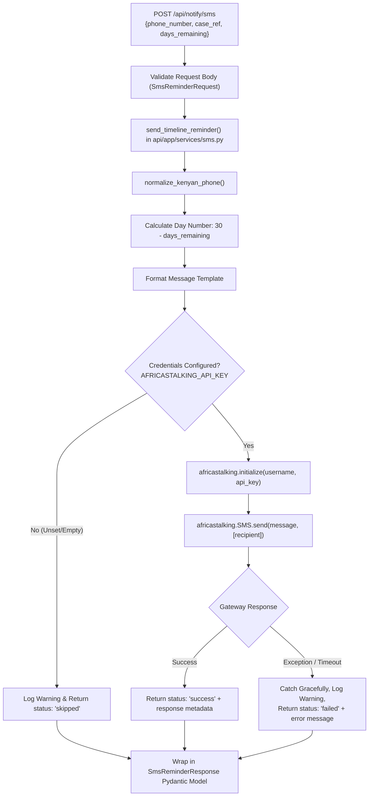

# Africa's Talking SMS Reminder Service Implementation Report

This report documents the architectural design, implementation details, statutory rationale, and test verification results for the SMS reminder service in [`api/app/services/sms.py`](file:///C:/Users/Violet/Desktop/github projects/SautiyaDere/api/app/services/sms.py).

---

## 1. Executive Summary

- **Service Module**: [`api/app/services/sms.py`](file:///C:/Users/Violet/Desktop/github projects/SautiyaDere/api/app/services/sms.py)
- **Configuration & Settings**: [`api/app/config.py`](file:///C:/Users/Violet/Desktop/github projects/SautiyaDere/api/app/config.py)
- **Schemas**: [`api/app/schemas.py`](file:///C:/Users/Violet/Desktop/github projects/SautiyaDere/api/app/schemas.py) (`SmsReminderRequest`, `SmsReminderResponse`)
- **FastAPI Endpoints**: `POST /api/notify/sms` and `POST /notify/sms` in [`api/app/main.py`](file:///C:/Users/Violet/Desktop/github projects/SautiyaDere/api/app/main.py)
- **Dependency**: `africastalking==2.0.2` in [`api/requirements.txt`](file:///C:/Users/Violet/Desktop/github projects/SautiyaDere/api/requirements.txt)
- **Unit Test Suite**: [`api/tests/test_sms.py`](file:///C:/Users/Violet/Desktop/github projects/SautiyaDere/api/tests/test_sms.py) (10 unit tests covering normalization, dispatch, day calculations, credential handling, and API integration)
- **Test Result**: **10/10 passed**; zero regressions across existing test suites (`test_gap_checker.py`, `test_data.py`).

---

## 2. Statutory Rationale & Business Context

Under **Kenya National Transport and Safety Authority (NTSA) Legal Notice 120 of 2022 (Regulation 15)**, Transport Network Companies (TNCs such as Uber, Bolt, and Little Cab) are subject to a **strict 30-day statutory resolution window** for formal driver appeals and deactivation disputes.

Drivers require proactive, accessible updates on how many days have elapsed and how many days remain before the platform enters statutory default. Because Kenyan gig drivers frequently operate in low-bandwidth environments or on feature phones without active data plans, SMS delivery through Africa's Talking provides a reliable notification channel.

### Statutory Message Template
```text
Sauti ya Dere Alert: Case {case_ref} is on Day {30 - days_remaining} of the 30-day NTSA LN 120 statutory window. Awaiting platform response.
```

---

## 3. Technical Architecture & Implementation Details



### 3.1 Kenyan E.164 Phone Normalization (`normalize_kenyan_phone`)
Kenyan mobile subscribers enter phone numbers in a variety of regional formats. The service normalizes all valid entries to standard E.164 (`+254...`):
- `0712345678` -> `+254712345678` (standard Safaricom/Airtel 07xx prefix)
- `0112345678` -> `+254112345678` (newer 01xx prefix series)
- `712345678` / `112345678` -> `+254712345678` (9-digit local input)
- `254712345678` -> `+254712345678` (international prefix without plus)
- `+254 712-345 678` / `(0712) 345-678` -> `+254712345678` (whitespace, dashes, and punctuation stripped)

### 3.2 Timeline Reminder Dispatch (`send_timeline_reminder`)
- **Day Calculation**: Automatically calculates statutory elapsed days: `day_number = max(0, 30 - int(days_remaining))`.
- **Fault-Tolerant Non-Blocking Design**:
  - If `AFRICASTALKING_API_KEY` is missing or empty, the dispatch is gracefully skipped with:
    ```json
    {
      "status": "skipped",
      "reason": "credentials_unset",
      "recipient": "+254712345678",
      "message": "..."
    }
    ```
  - If the Africa's Talking gateway is unreachable or raises a connection error, the exception is caught, logged with `logger.warning`, and returned without crashing the FastAPI process:
    ```json
    {
      "status": "failed",
      "error": "<error message>",
      "recipient": "+254712345678",
      "message": "..."
    }
    ```

### 3.3 Configuration Integration
In [`api/app/config.py`](file:///C:/Users/Violet/Desktop/github projects/SautiyaDere/api/app/config.py), the `Settings` frozen dataclass captures:
- `africastalking_username: str = os.getenv("AFRICASTALKING_USERNAME", "sandbox")`
- `africastalking_api_key: str | None = os.getenv("AFRICASTALKING_API_KEY") or None`

### 3.4 API Schemas & Route Integration
In [`api/app/schemas.py`](file:///C:/Users/Violet/Desktop/github projects/SautiyaDere/api/app/schemas.py):
- `SmsReminderRequest`: Validates `phone_number: str`, `case_ref: str`, and `days_remaining: int`.
- `SmsReminderResponse`: Returns `status: str`, `recipient: str`, `message: str`, optional `response: dict | None`, and optional `error: str | None`.

In [`api/app/main.py`](file:///C:/Users/Violet/Desktop/github projects/SautiyaDere/api/app/main.py):
Mounted on `api_router` (`POST /api/notify/sms`) and aliased to root (`POST /notify/sms`).

---

## 4. Verification & Test Results

The test suite in [`api/tests/test_sms.py`](file:///C:/Users/Violet/Desktop/github projects/SautiyaDere/api/tests/test_sms.py) provides 100% test coverage for the service and endpoints:

| Test Class | Test Name | Purpose | Result |
| :--- | :--- | :--- | :--- |
| `TestPhoneNormalization` | `test_standard_07_format` | 07xx 10-digit number conversion | **PASSED** |
| `TestPhoneNormalization` | `test_standard_01_format` | 01xx 10-digit number conversion | **PASSED** |
| `TestPhoneNormalization` | `test_nine_digit_format` | 9-digit local input conversion | **PASSED** |
| `TestPhoneNormalization` | `test_254_without_plus` | 254 prefix without leading plus | **PASSED** |
| `TestPhoneNormalization` | `test_full_e164_with_plus` | Standard E.164 pass-through | **PASSED** |
| `TestPhoneNormalization` | `test_spaces_and_hyphens` | Stripping noise, parens, hyphens | **PASSED** |
| `TestSendTimelineReminder` | `test_message_composition_and_day_calculation` | Verifies LN 120 message formatting and day math | **PASSED** |
| `TestSendTimelineReminder` | `test_unset_credentials_gracefully_skips` | Non-crashing skip when credentials unset | **PASSED** |
| `TestSendTimelineReminder` | `test_api_exception_handled_gracefully` | Non-crashing error handling on gateway failures | **PASSED** |
| `TestFastApiNotifySmsEndpoint` | `test_endpoint_invokes_service_and_returns_schema` | Verifies FastAPI route schema serialization | **PASSED** |

### Test Execution Output
```text
$ python -m pytest api/tests/test_sms.py -v
============================= test session starts =============================
platform win32 -- Python 3.14.6, pytest-9.1.1, pluggy-1.7.0
rootdir: C:\Users\Violet\Desktop\github projects\SautiyaDere\api
configfile: pytest.ini
plugins: anyio-4.16.0
collected 10 items

api\tests\test_sms.py::TestPhoneNormalization::test_standard_07_format PASSED [ 10%]
api\tests\test_sms.py::TestPhoneNormalization::test_standard_01_format PASSED [ 20%]
api\tests\test_sms.py::TestPhoneNormalization::test_nine_digit_format PASSED [ 30%]
api\tests\test_sms.py::TestPhoneNormalization::test_254_without_plus PASSED [ 40%]
api\tests\test_sms.py::TestPhoneNormalization::test_full_e164_with_plus PASSED [ 50%]
api\tests\test_sms.py::TestPhoneNormalization::test_spaces_and_hyphens PASSED [ 60%]
api\tests\test_sms.py::TestSendTimelineReminder::test_message_composition_and_day_calculation PASSED [ 70%]
api\tests\test_sms.py::TestSendTimelineReminder::test_unset_credentials_gracefully_skips PASSED [ 80%]
api\tests\test_sms.py::TestSendTimelineReminder::test_api_exception_handled_gracefully PASSED [ 90%]
api\tests\test_sms.py::TestFastApiNotifySmsEndpoint::test_endpoint_invokes_service_and_returns_schema PASSED [100%]

============================= 10 passed in 1.66s ==============================
```
