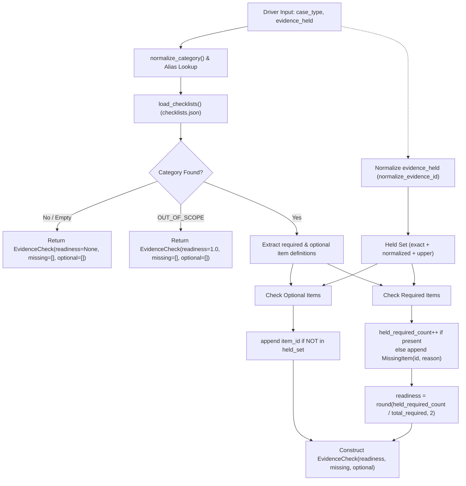

# Task T24: Evidence Gap Checker Implementation Report

This report documents the architectural design, implementation details, and verification results for Task T24: The Evidence Gap Checker service located in [`api/app/services/gap_checker.py`](file:///C:/Users/Violet/Desktop/github projects/SautiyaDere/api/app/services/gap_checker.py).

---

## 1. Executive Summary

- **Service Module**: [`api/app/services/gap_checker.py`](file:///C:/Users/Violet/Desktop/github projects/SautiyaDere/api/app/services/gap_checker.py)
- **Primary Function**: `evaluate_evidence_gaps(case_type: str, evidence_held: list[str] | None = None) -> EvidenceCheck`
- **Output Schema**: Returns an [`EvidenceCheck`](file:///C:/Users/Violet/Desktop/github projects/SautiyaDere/api/app/schemas.py#L47-L51) Pydantic model containing:
  - `readiness`: `float | None` (ratio of provided required items to total required items, rounded to 2 decimal places).
  - `missing`: `list[MissingItem]` (required items not currently held, populated with `id` and `reason`).
  - `optional`: `list[str]` (optional checklist items that the driver does **not** currently hold).
- **Test Suite**: [`api/tests/test_gap_checker.py`](file:///C:/Users/Violet/Desktop/github projects/SautiyaDere/api/tests/test_gap_checker.py) (11 unit tests covering all dispute types, legacy aliases, empty/None cases, and partial evidence states).
- **Verification Result**: **18/18 API tests passing** (`pytest api`).

---

## 2. Technical Architecture & Implementation Details



### 2.1 Resilient Data & Mapping Resolution
- **Environment-Agnostic Path Detection (`_find_data_dir`)**:
  Resolves the location of [`data/checklists.json`](file:///C:/Users/Violet/Desktop/github projects/SautiyaDere/data/checklists.json) across both local workspace checkouts (`<root>/data`) and Cloud Run container environments (`/srv/data`).
- **Dynamic Mappings Loader (`_load_mappings`)**:
  Safely imports `normalize_category` and `normalize_evidence_id` from [`data/mappings.py`](file:///C:/Users/Violet/Desktop/github projects/SautiyaDere/data/mappings.py) via standard import or dynamic spec loading, falling back to embedded lookup tables if `mappings.py` is inaccessible.
- **LRU Cached Checklists (`load_checklists`)**:
  Loads and parses `data/checklists.json` once, caching the resulting dictionary in memory with `@lru_cache(maxsize=1)`.

### 2.2 Category & Alias Normalization
The service supports multiple input conventions:
- **George's Internal Taxonomy**: `fare_dispute`, `passenger_safety`, `rating_or_cancellation`, `fraud_flag`, `account_verification`, `out_of_scope`.
- **Frontend / Contract Spec Aliases**: `FARE_PAYMENT_DISPUTE`, `PASSENGER_SAFETY_COMPLAINT`, `RATING_CANCELLATION_DISPUTE`, `ACCOUNT_FRAUD_FLAG`.
- **Authoritative NTSA / TAWU Domain Keys**: `PAYMENT_EARNINGS_HOLD`, `SAFETY_INCIDENT`, `CONDUCT_COMPLAINT`, `FRAUD_ACCUSATION`, `ACCOUNT_INTEGRITY`.

### 2.3 Evidence Matching & Readiness Calculation
1. **Held Evidence Normalization**:
   Each item in `evidence_held` is trimmed and expanded into its exact, uppercase, and legacy-normalized counterpart via `normalize_evidence_id()` (e.g. `TRIP_RECEIPT` expands to `TRIP_RECEIPT_SCREENSHOT`).
2. **Missing Items Generation**:
   For any missing required item, a [`MissingItem`](file:///C:/Users/Violet/Desktop/github projects/SautiyaDere/api/app/schemas.py#L42-L45) is created with:
   - `id`: The canonical `item_id` string from `checklists.json`.
   - `reason`: Evaluated as `item.get("reason") or item.get("label") or f"Required for {case_type} appeal."`.
3. **Readiness Score Formula**:
   $$\text{readiness} = \operatorname{round}\left(\frac{\text{held\_required\_count}}{\text{total\_required}}, 2\right)$$
   - Returns `1.0` if `total_required == 0` or if category is `out_of_scope`.
   - Returns `None` if the category is unmapped or unknown.
4. **Optional Items Filtering**:
   Following the contract documented in [`docs/api.md`](file:///C:/Users/Violet/Desktop/github projects/SautiyaDere/docs/api.md#L93), the `optional` list contains **only optional items that the driver does not yet hold**, ensuring optional items held by the driver are never redundantly recommended.

---

## 3. Test Coverage Matrix

The test suite in [`api/tests/test_gap_checker.py`](file:///C:/Users/Violet/Desktop/github projects/SautiyaDere/api/tests/test_gap_checker.py) verifies 11 distinct scenarios:

| Test Case | Scenario / Dispute Type | Evidence Input | Expected Readiness | Expected Missing Items | Expected Optional Items |
| :--- | :--- | :--- | :---: | :--- | :--- |
| `test_fare_dispute_empty_evidence` | `fare_dispute` (Empty) | `[]` | `0.0` | `TRIP_RECEIPT_SCREENSHOT`, `MPESA_STATEMENT` | `GPS_ROUTE_LOG`, `IN_APP_CHAT_SCREENSHOT` |
| `test_fare_dispute_partial_and_legacy_evidence` | `fare_dispute` (Legacy ID) | `["TRIP_RECEIPT"]` | `0.5` | `MPESA_STATEMENT` | `GPS_ROUTE_LOG`, `IN_APP_CHAT_SCREENSHOT` |
| `test_fare_dispute_all_required_and_optional` | `fare_dispute` (Complete + Opt) | Required + `GPS_ROUTE_LOG` | `1.0` | `[]` | `IN_APP_CHAT_SCREENSHOT` |
| `test_passenger_safety_case_type` | `passenger_safety` (Partial) | `["POLICE_ABSTRACT"]` | `0.5` | `INCIDENT_TIMESTAMP_LOG` | `DASHCAM_FOOTAGE`, `WITNESS_STATEMENT` |
| `test_rating_or_cancellation_case_type` | `rating_or_cancellation` (Empty) | `[]` | `0.0` | `IN_APP_CHAT_SCREENSHOT`, `DRIVER_COUNTER_STATEMENT` | `DASHCAM_FOOTAGE`, `DRIVER_RATING_HISTORY` |
| `test_fraud_flag_case_type` | `fraud_flag` (Complete + Opt) | Required + `LOCATION_HISTORY_EXPORT` | `1.0` | `[]` | `PASSENGER_MPESA_RECEIPT` |
| `test_account_verification_case_type` | `account_verification` (1 of 3) | `["NATIONAL_ID_DRIVER_LICENSE"]` | `0.33` | `PSV_BADGE_POLICE_CLEARANCE`, `VEHICLE_INSPECTION_INSURANCE` | `SELFIE_PHOTO`, `VEHICLE_PHOTOS` |
| `test_out_of_scope_case_type` | `out_of_scope` | `[]` | `1.0` | `[]` | `[]` |
| `test_uppercase_and_alias_case_types` | Screaming Snake Aliases | `FARE_PAYMENT_DISPUTE`, etc. | `0.0` | 2 per category | Preserved |
| `test_unknown_or_empty_case_type` | Invalid / Empty string | `""`, `"non_existent"` | `None` | `[]` | `[]` |
| `test_none_evidence_held_gracefully_handled` | None-safety | `None` | `0.0` | 2 items | Preserved |

---

## 4. Verification Output

Command executed:
```bash
cd api
python -m pytest
```

Output:
```
============================= test session starts =============================
platform win32 -- Python 3.14.6, pytest-9.1.1, pluggy-1.7.0
rootdir: C:\Users\Violet\Desktop\github projects\SautiyaDere\api
configfile: pytest.ini
testpaths: tests
plugins: anyio-4.16.0
collected 18 items

tests\test_api.py .......                                                [38%]
tests\test_gap_checker.py ...........                                    [100%]

============================= 18 passed in 3.65s ==============================
```

Whole repository tests verification:
```bash
cd data
python -m pytest
```
Output:
```
============================= 11 passed in 0.50s ==============================
```
