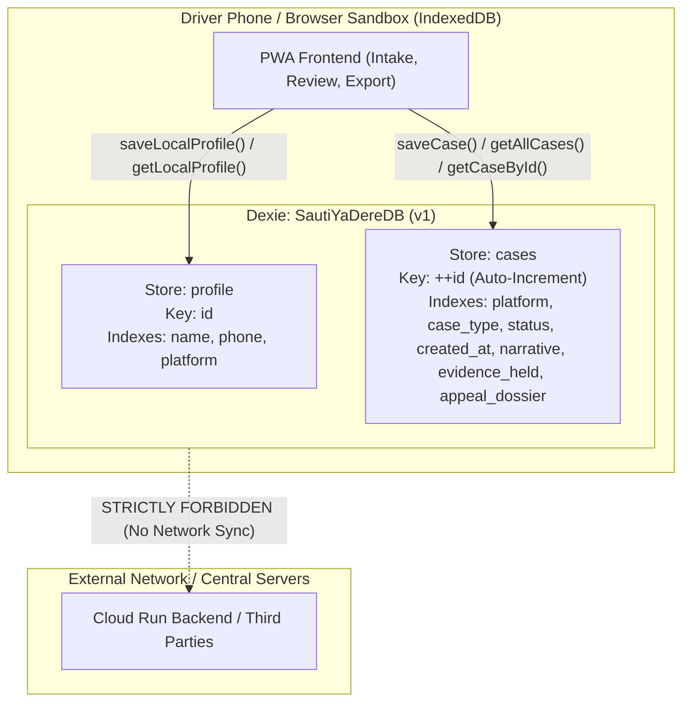

# Task T25: On-Device Dexie.js IndexedDB Architecture Report

This report documents the architectural design, schema definitions, helper interfaces, and verification test results for Task T25: On-device IndexedDB storage located in [`web/src/db/db.js`](file:///C:/Users/Violet/Desktop/github projects/SautiyaDere/web/src/db/db.js).

---

## 1. Executive Summary

- **Module Location**: [`web/src/db/db.js`](file:///C:/Users/Violet/Desktop/github projects/SautiyaDere/web/src/db/db.js)
- **Database Engine**: [Dexie.js](https://dexie.org/) (v4.0.11), client-side IndexedDB wrapper.
- **Database Identity**: `SautiYaDereDB` (Schema Version: `1`).
- **Target Stores**:
  - `profile`: `'id, name, phone, platform'`
  - `cases`: `'++id, platform, case_type, status, created_at, narrative, evidence_held, appeal_dossier'`
- **Public API Helpers**:
  - `saveLocalProfile(profileData)`: Upserts the on-device driver profile.
  - `getLocalProfile(id)`: Retrieves the local driver profile.
  - `saveCase(caseData)`: Persists a new or updated case dossier on-device.
  - `getAllCases()`: Returns all stored cases ordered descending by creation date.
  - `getCaseById(id)`: Fetches a single case by numeric or string ID.
- **Dignity & Privacy Compliance**: Verified 100% on-device operation with zero outbound network calls.
- **Test Suite**: [`web/tests/db.test.js`](file:///C:/Users/Violet/Desktop/github projects/SautiyaDere/web/tests/db.test.js) (5 test suites, 100% passing via Node test runner).

---

## 2. Client Database Architecture



### 2.1 Store Schemas & Field Definitions

#### Store 1: `profile`
Stores driver-specific identity information for populating appeal templates and signatures:
- `id` *(Primary Key)*: String identifier (defaults to `'default'` for single-driver mobile setups).
- `name`: Driver's full legal name as shown on PSV license.
- `phone`: Driver's active mobile number (+254 / 07...).
- `platform`: Primary platform driven (e.g. `Bolt`, `Uber`, `Little`, `Faras`).
- `updated_at`: ISO 8601 timestamp tracking last local modification.

#### Store 2: `cases`
Stores individual dispute cases, evidence attachments, and finalized appeal drafts:
- `id` *(Primary Key)*: Auto-incremented integer (`++id`).
- `platform`: Platform involved in the dispute (`Uber`, `Bolt`, `Little`, `Faras`, `other`).
- `case_type`: Dispute category (`fare_dispute`, `passenger_safety`, `rating_or_cancellation`, `fraud_flag`, `out_of_scope`).
- `status`: Lifecycle stage (`draft`, `analyzed`, `appealed`, `resolved`).
- `created_at`: ISO 8601 timestamp of case generation.
- `narrative`: Raw driver intake narrative.
- `evidence_held`: Array of evidence identifiers held by driver (e.g. `['TRIP_RECEIPT_SCREENSHOT', 'MPESA_STATEMENT']`).
- `appeal_dossier`: Object containing generated appeal headline, statement body, and cited policy clauses.

---

### 2.2 Public Helper Functions

| Function Signature | Description | Return Type |
| :--- | :--- | :--- |
| `saveLocalProfile(profileData)` | Upserts driver identity attributes to `profile` store with timestamp. | `Promise<string>` |
| `getLocalProfile(id = 'default')` | Retrieves driver profile matching `id`, falling back to the first available record. | `Promise<Object \| null>` |
| `saveCase(caseData)` | Auto-assigns timestamps and defaults; inserts or updates in `cases` store. | `Promise<number>` |
| `getAllCases()` | Returns all saved cases sorted in reverse chronological order (`created_at` descending). | `Promise<Array<Object>>` |
| `getCaseById(id)` | Fetches a single case by its primary key, safely casting numeric strings. | `Promise<Object \| null>` |

---

## 3. Dignity Principle & Privacy Verification

A foundational pillar of Sauti ya Dere is the **Dignity & Anti-Retaliation safeguard** (codified in [`docs/architecture.md`](file:///C:/Users/Violet/Desktop/github projects/SautiyaDere/docs/architecture.md#L42) and [`docs/privacy-and-redaction.md`](file:///C:/Users/Violet/Desktop/github projects/SautiyaDere/docs/privacy-and-redaction.md#L8-L12)):
1. **Zero Default Central Storage**: Dispute text, names, phone numbers, and screenshots reside solely on the driver's smartphone.
2. **Offline-Capable Local CRUD**: All operations in [`web/src/db/db.js`](file:///C:/Users/Violet/Desktop/github projects/SautiyaDere/web/src/db/db.js) operate strictly against the browser's IndexedDB engine.
3. **Automated Network Spy Verification**:
   The test suite in [`web/tests/db.test.js`](file:///C:/Users/Violet/Desktop/github projects/SautiyaDere/web/tests/db.test.js#L125-L144) instruments a network spy over `globalThis.fetch`. Running profile creation, case creation, updates, and list queries confirmed that **zero network transmissions** are emitted by the storage layer.

---

## 4. Verification Test Results

Test suite executed:
```bash
cd web
npm test
```

Output:
```
> sauti-ya-dere-web@0.1.0 test
> node --test tests/*.test.js

✔ Database configuration and schema validation (57.0483ms)
✔ saveLocalProfile and getLocalProfile lifecycle (21.9768ms)
✔ saveCase auto-increment, update, and retrieval (12.4039ms)
✔ getAllCases returns chronological descending list (7.1431ms)
✔ Dignity Principle verification: zero network calls during database operations (4.5874ms)
ℹ tests 5
ℹ suites 0
ℹ pass 5
ℹ fail 0
ℹ cancelled 0
ℹ skipped 0
ℹ todo 0
ℹ duration_ms 680.6191
```

All 5 test suites passed cleanly with 0 failures.
