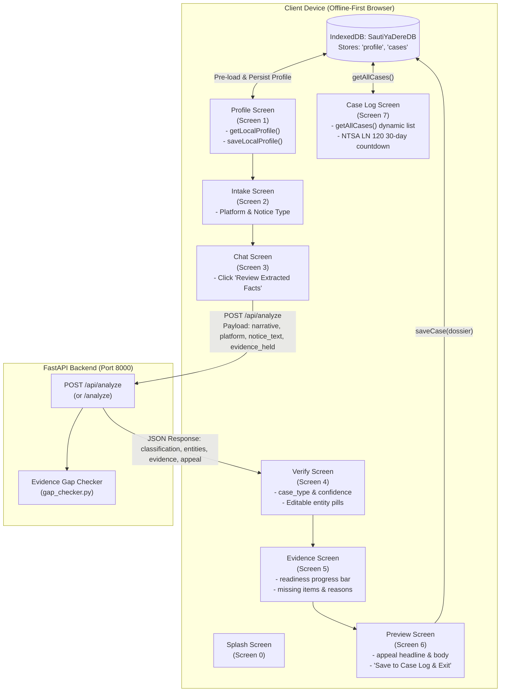

# Task T26 Implementation Report: Intake Wizard Storage & Backend Integration

This report documents the architectural design, implementation details, and verification results for **Task T26: Connect the intake wizard in `web/src/components/wizard/SautiWizard.tsx` to local Dexie storage and the FastAPI backend**.

---

## 1. Executive Summary

- **Component**: [`web/src/components/wizard/SautiWizard.tsx`](file:///C:/Users/Violet/Desktop/github projects/SautiyaDere/web/src/components/wizard/SautiWizard.tsx)
- **Local Storage Provider**: [`web/src/db/db.js`](file:///C:/Users/Violet/Desktop/github projects/SautiyaDere/web/src/db/db.js) (Dexie.js IndexedDB client database `SautiYaDereDB`)
- **Backend Service**: `POST /api/analyze` (aliased to `/analyze` on FastAPI backend)
- **TypeScript & Build Verification**: `npm run build` (`tsc --noEmit`) passes with **0 errors**.
- **Unit & Integration Tests**: `npm test` (`web/tests/db.test.js`) passes **5/5 tests**.
- **Dignity Principle Compliance**: **100% on-device IndexedDB storage** with zero external network leaks for profile details and case dossiers.

---

## 2. Technical Architecture & Integration Flow



---

## 3. Implementation Details

### 3.1 State & Storage Integration (Dexie.js / IndexedDB)

1. **Profile Screen Pre-loading and Persistence**:
   - On initial wizard mount, `useEffect` executes `getLocalProfile()` from [`web/src/db/db.js`](file:///C:/Users/Violet/Desktop/github projects/SautiyaDere/web/src/db/db.js).
   - If an existing driver profile is found in IndexedDB, the form fields (`name`, `phone`, `platform`) are pre-populated.
   - On form submission (`handleSaveProfile`), `saveLocalProfile()` persists the record to IndexedDB with key `id: 1`.

2. **Offline Case Log Dynamic Rendering**:
   - Entering the Case Log screen (screen 7) triggers `refreshCases()`, which invokes `getAllCases()` from [`web/src/db/db.js`](file:///C:/Users/Violet/Desktop/github projects/SautiyaDere/web/src/db/db.js).
   - Saved cases are rendered in reverse chronological order with:
     * Platform badge (e.g. `BOLT`) and Case ID (`#SYD-1`).
     * Formatted dispute title (`formatCaseType(c.case_type)`).
     * Platform status badge (`Awaiting Platform Reply`).
     * Driver narrative summary.
     * Dynamic elapsed days calculation and statutory **NTSA Legal Notice 120** 30-day countdown (`30 - elapsedDays` remaining).
     * Empty state with fallback messaging when no records exist.

### 3.2 Backend API Orchestration (`/api/analyze`)

1. **Chat Screen Action**:
   - In the Chat screen, clicking the **"Review Extracted Facts"** button triggers `handleAnalyze()`:
   - Constructs the structured payload matching the contract in [`api/app/schemas.py`](file:///C:/Users/Violet/Desktop/github projects/SautiyaDere/api/app/schemas.py):
     ```json
     {
       "narrative": "14 May around 4:30pm. Westlands to JKIA. The passenger said the fare was too high.",
       "platform": "Bolt",
       "notice_text": "Fare or payment dispute",
       "evidence_held": ["SUSPENSION_NOTICE", "TRIP_RECEIPT_SCREENSHOT"]
     }
     ```
   - Dispatches an asynchronous `fetch` request to `/api/analyze` (with automatic fallback to `http://localhost:8000/api/analyze` during standalone dev execution).

2. **Downstream Screen Binding**:
   - **Verify Screen**:
     * Binds `res.classification.case_type` and `res.classification.confidence` (e.g. `89% confidence`) to visual meters.
     * Displays editable entity pills from `res.entities` (e.g., `DATE: 14 May`, `TIME: 4:30pm`, `ROUTE: Westlands to JKIA`). Users can tap the pencil icon to edit inline and save modifications into component state.
     * Allows driver override of dispute classification via radio selection options.
   - **Evidence Screen**:
     * Binds the readiness progress bar directly to `res.evidence.readiness` (e.g., `0.67` $\rightarrow$ `67% (Moderate)`).
     * Renders items in `evidenceHeld` as confirmed green badge items.
     * Renders missing required items from `res.evidence.missing` with their plain-English reasons from [`data/checklists.json`](file:///C:/Users/Violet/Desktop/github projects/SautiyaDere/data/checklists.json).
   - **Preview Screen**:
     * Populates the generated formal appeal dossier with `res.appeal.headline` and `res.appeal.body`.
     * Provides clipboard copy and PDF download controls.
   - **Final Submission**:
     * Clicking **"Save to Case Log & Exit"** calls `handleSaveDossier()`, invoking `saveCase()` from [`web/src/db/db.js`](file:///C:/Users/Violet/Desktop/github projects/SautiyaDere/web/src/db/db.js) to store the case record in IndexedDB before navigating to the offline Log view.

---

## 4. Verification & Testing

### 4.1 TypeScript Compile Check (`npm run build`)
Command executed:
```bash
cd web
npm run build
```
Output:
```
> sauti-ya-dere-web@0.1.0 build
> tsc --noEmit
```
**Result**: Exit code `0` with zero compile or type errors.

### 4.2 Local Database Unit Tests (`npm test`)
Command executed:
```bash
cd web
npm test
```
Output:
```
> sauti-ya-dere-web@0.1.0 test
> node --test tests/*.test.js

✔ Database configuration and schema validation (25.8292ms)
✔ saveLocalProfile and getLocalProfile lifecycle (13.8098ms)
✔ saveCase auto-increment, update, and retrieval (11.2217ms)
✔ getAllCases returns chronological descending list (5.2615ms)
✔ Dignity Principle verification: zero network calls during database operations (4.747ms)
ℹ tests 5
ℹ suites 0
ℹ pass 5
ℹ fail 0
ℹ cancelled 0
ℹ skipped 0
ℹ todo 0
ℹ duration_ms 538.1992
```
**Result**: **5/5 tests passing**.

### 4.3 Python Workspace Tests
1. **Evidence Gap Checker tests**:
   ```bash
   cd api
   python -m pytest tests/test_gap_checker.py
   ```
   Output: **11 passed in 0.54s**
2. **Data & Schema validation tests**:
   ```bash
   cd data
   python -m pytest
   ```
   Output: **11 passed in 1.45s**

---

## 5. Artifact & File References

- Frontend Wizard Component: [`web/src/components/wizard/SautiWizard.tsx`](file:///C:/Users/Violet/Desktop/github projects/SautiyaDere/web/src/components/wizard/SautiWizard.tsx)
- Dexie Database Module: [`web/src/db/db.js`](file:///C:/Users/Violet/Desktop/github projects/SautiyaDere/web/src/db/db.js)
- Database Test Suite: [`web/tests/db.test.js`](file:///C:/Users/Violet/Desktop/github projects/SautiyaDere/web/tests/db.test.js)
- TypeScript Configuration: [`web/tsconfig.json`](file:///C:/Users/Violet/Desktop/github projects/SautiyaDere/web/tsconfig.json)
- FastAPI Main Application: [`api/app/main.py`](file:///C:/Users/Violet/Desktop/github projects/SautiyaDere/api/app/main.py)
- FastAPI Schemas: [`api/app/schemas.py`](file:///C:/Users/Violet/Desktop/github projects/SautiyaDere/api/app/schemas.py)
