# Task T35 Implementation Report: Client-Side 1-Page PDF Dossier Generation

This report documents the architectural design, layout specifications, verification results, and UI integration for **Task T35: Client-side 1-Page PDF Dossier Generation using `pdf-lib` in `web/src/utils/pdfGenerator.js`**.

---

## 1. Executive Summary

- **Module**: [`web/src/utils/pdfGenerator.js`](file:///C:/Users/Violet/Desktop/github projects/SautiyaDere/web/src/utils/pdfGenerator.js)
- **Engine**: [`pdf-lib`](https://pdf-lib.js.org/) (v1.17.1), a pure JavaScript/TypeScript vector PDF manipulation engine with zero native dependencies.
- **Primary Export**: `generateAppealPdf({ driverProfile, caseData, appealDossier })`
- **Output Characteristics**:
  - **Page Format**: Standard ISO 216 **A4** (`595.28 × 841.89` pt).
  - **Page Count**: **Strictly 1 Page** (`pageCount === 1`), guaranteed by deterministic vertical coordinate budgeting and text wrapping guards.
  - **Output File Size**: **3,695 bytes (~3.61 KB)** — ultra-compact, bandwidth-free, and instantly transmissible over 2G/3G networks or WhatsApp.
- **Privacy & Dignity Compliance**: **100% Client-Side On-Device Generation**. Zero document bytes or driver PII are uploaded to any server or external cloud API.
- **UI Integration**: Connected to the **"Download 1-Page PDF"** action in Screen 6 (Preview) of [`web/src/components/wizard/SautiWizard.tsx`](file:///C:/Users/Violet/Desktop/github projects/SautiyaDere/web/src/components/wizard/SautiWizard.tsx).

---

## 2. 1-Page A4 Coordinate & Layout Architecture

Standard A4 dimensions in PDF points ($1\text{ pt} = \frac{1}{72}\text{ inch}$):
$$\text{Width} = 595.28\text{ pt}\quad (210\text{ mm}),\quad \text{Height} = 841.89\text{ pt}\quad (297\text{ mm})$$

With a symmetric margin of $36.0\text{ pt}$ ($0.5\text{ in}$), the usable canvas is:
$$\text{Content Width} = 595.28 - (2 \times 36.0) = 523.28\text{ pt}$$
$$\text{Content Height} = 841.89 - (2 \times 36.0) = 769.89\text{ pt}$$

```mermaid
flowchart TD
    subgraph A4Canvas ["A4 Single-Page Canvas (595.28 x 841.89 pt)"]
        direction TB
        Header["Header Bar & Brand Accent (y: 805 -> 760)\n'SAUTI YA DERE — FORMAL DISPUTE DOSSIER' · Case Ref · Date"]
        Sec1["Section 1: Driver & Vehicle Identity (y: 750 -> 692)\nDriver Name · Hailing Platform · Registered MSISDN"]
        Sec2["Section 2: Statutory Reference & Authority (y: 682 -> 628)\nNTSA Legal Notice 120 Reg 15 · Kenya Data Protection Act 2019 Sec 26"]
        Sec3["Section 3: Chronological Trip Facts (y: 618 -> 572)\nIncident Date · Estimated Time · Route / Location · Disputed Fare"]
        Sec4["Section 4: Formal Statement Body (y: 562 -> 440)\nStructured Grounds · Wrapped Narrative · Platform Addressed"]
        Sec5["Section 5: Corroborated Evidence Checklist (y: 430 -> 376)\nAttached On-Device Files · Vector Verified Checkmarks"]
        Sec6["Section 6: Driver Declaration & Sign-off (y: 366 -> 314)\nTruth Affirmation · Driver Signature Line · TAWU Advocacy Reference"]
        Footer["Footer Bar (y: 65 -> 36)\nOn-Device Security Declaration · TAWU Partnership Attribution"]
    end
```



### Vertical Space Budget Allocation

| Vertical Segment | Start Y (pt) | End Y (pt) | Height (pt) | Elements & Design Treatment |
|---|---|---|---|---|
| **Header & Metadata** | 805.89 | 759.89 | 46.00 | 16pt Forest Green title, Case Ref (`#SYD-APP-YYYY-XXXX`), Date, 2pt divider rule. |
| **1. Driver Identity** | 750.00 | 702.00 | 48.00 | 3-column light-green card (`#F1F9F3`), border (`#B9DCC6`), labels + bold values. |
| **2. Statutory Authority** | 690.00 | 634.00 | 56.00 | Cream/Amber callout (`#FFFCF7`), 3.5pt amber indicator, NTSA LN 120 Reg 15 & KDPA Sec 26 citations. |
| **3. Chronological Facts** | 622.00 | 574.00 | 48.00 | 4-column table grid (`#F8FAFC`): Date, Time, Route/Location, Disputed Fare. |
| **4. Statement of Appeal** | 562.00 | 436.00 | 126.00 | White card with border (`#E2E8F0`), bold headline, up to 9 wrapped lines of narrative (8pt, 11pt line-height). |
| **5. Evidence Checklist** | 424.00 | 368.00 | 56.00 | 2-column checklist, `#F1F9F3` background, crisp vector-drawn green checkmark badges. |
| **6. Driver Declaration** | 356.00 | 304.00 | 52.00 | Formal legal declaration (Italic), signature line, TAWU-Kenya Union Reference (`TAWU-KE / DISP / 2026`). |
| **Buffer / Breathing Space** | 304.00 | 65.00 | 239.00 | Guaranteed non-overflow zone preventing page spilling under any narrative length. |
| **Footer Block** | 65.00 | 36.00 | 29.00 | Top divider rule, TAWU attribution, zero-knowledge architecture guarantee. |

---

## 3. Statutory Citations Codified in the Document

The generated dossier explicitly cites two statutory instruments recognized under Kenyan law:

1. **NTSA (Operation of Digital Hailing Operators) Regulations, 2022 (Legal Notice No. 120), Regulation 15**:
   - Mandates that ride-hailing operators establish a fair and accessible dispute resolution mechanism.
   - Imposes a strict **30-day statutory resolution timeline** from the date of appeal submission.
   - Precludes arbitrary deactivations without objective review of driver-submitted evidence.

2. **Kenya Data Protection Act, 2019 (Act No. 24 of 2019), Section 26**:
   - Codifies the statutory right of data subjects to be informed of automated decision-making.
   - Entitles drivers to obtain meaningful explanations regarding algorithmic flags or automated account suspensions.
   - Guarantees the right to rectify false or inaccurate trip records held by the platform.

---

## 4. UI Integration in `SautiWizard.tsx`

In [`web/src/components/wizard/SautiWizard.tsx`](file:///C:/Users/Violet/Desktop/github projects/SautiyaDere/web/src/components/wizard/SautiWizard.tsx), the Screen 6 (Preview) component was updated:

- **State Management**: Added `generatingPdf` and `pdfSuccess` boolean states.
- **Button Binding**:
  ```tsx
  <Btn secondary onClick={handleDownloadPdf} disabled={generatingPdf}>
    <Download size={16} /> {generatingPdf ? 'Generating…' : pdfSuccess ? 'Downloaded!' : 'Download 1-Page PDF'}
  </Btn>
  ```
- **Handler Implementation**:
  ```typescript
  const handleDownloadPdf = async () => {
    setGeneratingPdf(true)
    try {
      await generateAppealPdf({
        driverProfile: profile,
        caseData: {
          platform: platform || profile.platform || 'Bolt',
          narrative,
          entities: analysis.entities,
          evidence_held: evidenceHeld
        },
        appealDossier: {
          headline,
          statement_body: bodyText,
          policy_rules: analysis.appeal.policy_rules,
          evidence_held: evidenceHeld
        }
      })
      setPdfSuccess(true)
      setTimeout(() => setPdfSuccess(false), 3000)
    } catch (err) {
      console.error('Failed to generate appeal PDF:', err)
    } finally {
      setGeneratingPdf(false)
    }
  }
  ```
- **Download Automation**:
  - Automatically creates a temporary `Blob` (`application/pdf`) and initiates download via `<a download="SautiYaDere_Appeal_SYD-APP-YYYY-XXXX.pdf">`.
  - Automatically cleans up the object URL with `URL.revokeObjectURL(url)` to prevent memory leaks.

---

## 5. Verification & Test Results

### 5.1 Unit Tests (`npm test`)
Command executed:
```bash
npm --prefix web test
```
Output:
```
> sauti-ya-dere-web@0.1.0 test
> node --test tests/*.test.js

✔ Database configuration and schema validation (30.5554ms)
✔ saveLocalProfile and getLocalProfile lifecycle (23.7285ms)
✔ saveCase auto-increment, update, and retrieval (11.2039ms)
✔ getAllCases returns chronological descending list (7.4419ms)
✔ Dignity Principle verification: zero network calls during database operations (6.6395ms)
Generated PDF size: 3695 bytes (~3.61 KB)
✔ generateAppealPdf produces a valid 1-page A4 document (122.8401ms)
✔ generateAppealPdf handles empty/sparse arguments gracefully (25.4145ms)
ℹ tests 7
ℹ suites 0
ℹ pass 7
ℹ fail 0
ℹ cancelled 0
ℹ skipped 0
ℹ todo 0
ℹ duration_ms 1001.299
```
**Result**: **7/7 tests passing** in 1.00s.

### 5.2 TypeScript Build Check (`npm run build`)
Command executed:
```bash
npm --prefix web run build
```
Output:
```
> sauti-ya-dere-web@0.1.0 build
> tsc --noEmit
```
**Result**: Exit code `0` with zero compile or type errors.

### 5.3 Python Subsystem Tests
- `python -m pytest api/tests/test_gap_checker.py`: **11/11 passed** (0.69s).
- `python -m pytest data/tests/test_data.py`: **11/11 passed** (0.63s).

---

## 6. Artifact & File References

- PDF Generator Module: [`web/src/utils/pdfGenerator.js`](file:///C:/Users/Violet/Desktop/github projects/SautiyaDere/web/src/utils/pdfGenerator.js)
- PDF Unit Test Suite: [`web/tests/pdfGenerator.test.js`](file:///C:/Users/Violet/Desktop/github projects/SautiyaDere/web/tests/pdfGenerator.test.js)
- Intake Wizard Component: [`web/src/components/wizard/SautiWizard.tsx`](file:///C:/Users/Violet/Desktop/github projects/SautiyaDere/web/src/components/wizard/SautiWizard.tsx)
- Dexie Database Module: [`web/src/db/db.js`](file:///C:/Users/Violet/Desktop/github projects/SautiyaDere/web/src/db/db.js)
- Package Manifest: [`web/package.json`](file:///C:/Users/Violet/Desktop/github projects/SautiyaDere/web/package.json)
