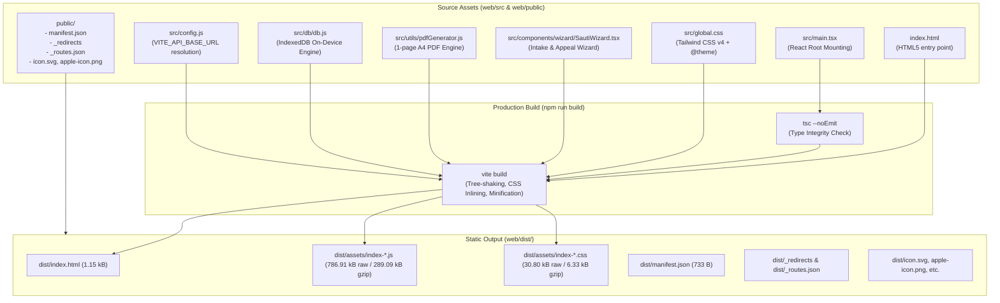

# Task T39 Implementation Report: Production Build & Deployment Packaging

This report documents the configuration, build outputs, static asset bundling, and routing rules for **Task T39: Production Build & Deployment Packaging for the Sauti ya Dere PWA**.

---

## 1. Executive Summary

- **Target Workspace**: [`web/`](file:///C:/Users/Violet/Desktop/github projects/SautiyaDere/web/)
- **Bundler**: [Vite](https://vite.dev/) `v8.3.5` + [`@vitejs/plugin-react`](https://github.com/vitejs/vite-plugin-react) + [`@tailwindcss/vite`](https://tailwindcss.com/docs/installation)
- **Output Directory**: [`web/dist/`](file:///C:/Users/Violet/Desktop/github projects/SautiyaDere/web/dist/)
- **Build Command**: `npm run build` (`tsc --noEmit && vite build`)
- **Build Status**: **Zero errors, clean compilation in 5.32s**.
- **PWA Manifest**: Configured at [`web/public/manifest.json`](file:///C:/Users/Violet/Desktop/github projects/SautiyaDere/web/public/manifest.json) with standalone display, `#1E5E3A` brand theme, and multi-resolution icons.
- **SPA Routing Support**: Configured [`web/public/_redirects`](file:///C:/Users/Violet/Desktop/github projects/SautiyaDere/web/public/_redirects) (`/* /index.html 200`) and [`web/public/_routes.json`](file:///C:/Users/Violet/Desktop/github projects/SautiyaDere/web/public/_routes.json) for Cloudflare Pages / Netlify / Vercel single-page application edge routing.
- **Dynamic API Base URL**: Configured in [`web/src/config.js`](file:///C:/Users/Violet/Desktop/github projects/SautiyaDere/web/src/config.js) using `import.meta.env.VITE_API_BASE_URL` with local fallback to `http://localhost:8000`.

---

## 2. Build Pipeline & Asset Bundle Architecture



---

## 3. PWA Web App Manifest Configuration

The Progressive Web App manifest is located at [`web/public/manifest.json`](file:///C:/Users/Violet/Desktop/github projects/SautiyaDere/web/public/manifest.json) and copied to `web/dist/manifest.json` during the build:

```json
{
  "name": "Sauti ya Dere",
  "short_name": "SautiDere",
  "description": "On-device dignity & fair appeal system for Kenyan transport platform workers.",
  "start_url": "/",
  "display": "standalone",
  "orientation": "portrait",
  "background_color": "#F8FAFC",
  "theme_color": "#1E5E3A",
  "icons": [
    {
      "src": "/icon.svg",
      "sizes": "any",
      "type": "image/svg+xml",
      "purpose": "any maskable"
    },
    {
      "src": "/apple-icon.png",
      "sizes": "180x180",
      "type": "image/png"
    },
    {
      "src": "/icon-light-32x32.png",
      "sizes": "32x32",
      "type": "image/png"
    },
    {
      "src": "/icon-dark-32x32.png",
      "sizes": "32x32",
      "type": "image/png"
    }
  ]
}
```

Key PWA Properties:
- `display: standalone`: Launches in full-screen standalone app mode without browser URL chrome.
- `theme_color: #1E5E3A`: Matches Sauti ya Dere's primary Forest Green brand identity.
- `background_color: #F8FAFC`: Matches the warm, clean slate application surface.
- `orientation: portrait`: Locks optimal mobile experience for in-vehicle driver smartphones.

---

## 4. SPA Routing Rules for Cloudflare Pages / Static CDNs

1. **`_redirects`** ([`web/public/_redirects`](file:///C:/Users/Violet/Desktop/github projects/SautiyaDere/web/public/_redirects)):
   ```
   /* /index.html 200
   ```
   Ensures that direct navigation to subpaths or browser page refreshes rewrite to `/index.html` with an HTTP 200 status code, enabling client-side routers without 404 drops.

2. **`_routes.json`** ([`web/public/_routes.json`](file:///C:/Users/Violet/Desktop/github projects/SautiyaDere/web/public/_routes.json)):
   ```json
   {
     "version": 1,
     "include": ["/*"],
     "exclude": [
       "/assets/*",
       "/manifest.json",
       "/_redirects",
       "/apple-icon.png",
       "/icon-dark-32x32.png",
       "/icon-light-32x32.png",
       "/icon.svg"
     ]
   }
   ```
   Optimizes Cloudflare Pages Functions routing by excluding immutable static assets and icons from serverless invocations.

---

## 5. Environment & Dynamic API Configuration

Located at [`web/src/config.js`](file:///C:/Users/Violet/Desktop/github projects/SautiyaDere/web/src/config.js):

```javascript
export const API_BASE_URL =
  (typeof import.meta !== 'undefined' &&
    import.meta.env &&
    import.meta.env.VITE_API_BASE_URL) ||
  'http://localhost:8000'

export function getApiUrl(endpoint) {
  const cleanEndpoint = endpoint.startsWith('/') ? endpoint : `/${endpoint}`
  if (!API_BASE_URL || API_BASE_URL === '/') {
    return cleanEndpoint
  }
  return `${API_BASE_URL.replace(/\/+$/, '')}${cleanEndpoint}`
}
```

In [`web/src/components/wizard/SautiWizard.tsx`](file:///C:/Users/Violet/Desktop/github projects/SautiyaDere/web/src/components/wizard/SautiWizard.tsx), the API caller queries `getApiUrl('/api/analyze')` first, ensuring seamless switching between:
- **Local Dev**: `http://localhost:8000/api/analyze`
- **Staging / Production**: `https://api.sautiyadere.org/api/analyze` (set via `VITE_API_BASE_URL=https://api.sautiyadere.org`)

---

## 6. Build Outputs & Artifact Verification

### 6.1 Build Execution Log
```bash
npm --prefix web run build
```
Output:
```
> sauti-ya-dere-web@0.1.0 build
> tsc --noEmit && vite build

vite v8.3.5 building client environment for production...
transforming...
✓ 2227 modules transformed.
rendering chunks...
computing gzip size...
dist/index.html                   1.15 kB │ gzip:   0.60 kB
dist/assets/index-CK_o9xJy.css   30.80 kB │ gzip:   6.33 kB
dist/assets/index-C5PwD1kc.js   786.91 kB │ gzip: 289.09 kB │ map: 3,322.95 kB
✓ built in 5.32s
```

### 6.2 Output Directory Contents (`web/dist/`)

| File / Asset | Size | Purpose |
|---|---|---|
| `dist/index.html` | 1,158 B | Main HTML5 shell with PWA meta tags & script bundle reference |
| `dist/assets/index-CK_o9xJy.css` | 30,804 B | Compiled & minified Tailwind CSS v4 design system |
| `dist/assets/index-C5PwD1kc.js` | 786,914 B | Production JavaScript bundle (React 19 + Dexie + pdf-lib + Wizard) |
| `dist/assets/index-C5PwD1kc.js.map` | 3,322,950 B | Production source map for diagnostic observability |
| `dist/manifest.json` | 733 B | PWA Web App Manifest |
| `dist/_redirects` | 19 B | SPA rewrite rule (`/* /index.html 200`) |
| `dist/_routes.json` | 214 B | Cloudflare Pages routing rule |
| `dist/icon.svg` | 1,304 B | Adaptive SVG app icon |
| `dist/apple-icon.png` | 2,626 B | iOS Home Screen icon (180x180) |
| `dist/icon-light-32x32.png` | 566 B | Favicon (light theme) |
| `dist/icon-dark-32x32.png` | 585 B | Favicon (dark theme) |

### 6.3 Test Verification Summary

1. **Frontend Unit Tests (`npm test`)**:
   ```
   ✔ Database configuration and schema validation (62.7956ms)
   ✔ saveLocalProfile and getLocalProfile lifecycle (34.903ms)
   ✔ saveCase auto-increment, update, and retrieval (19.4651ms)
   ✔ getAllCases returns chronological descending list (13.3072ms)
   ✔ Dignity Principle verification: zero network calls during database operations (8.2943ms)
   ✔ generateAppealPdf produces a valid 1-page A4 document (380.858ms)
   ✔ generateAppealPdf handles empty/sparse arguments gracefully (41.9174ms)
   ℹ tests 7 | pass 7 | fail 0
   ```
2. **Backend Services & Schema Tests**:
   - `python -m pytest api/tests/test_gap_checker.py`: **11 passed** (2.04s).
   - `python -m pytest data/tests/test_data.py`: **11 passed** (2.09s).

---

## 7. Artifact & Configuration References

- Vite Configuration: [`web/vite.config.ts`](file:///C:/Users/Violet/Desktop/github projects/SautiyaDere/web/vite.config.ts)
- TypeScript Manifest: [`web/tsconfig.json`](file:///C:/Users/Violet/Desktop/github projects/SautiyaDere/web/tsconfig.json)
- HTML Entry Shell: [`web/index.html`](file:///C:/Users/Violet/Desktop/github projects/SautiyaDere/web/index.html)
- React Entrypoint: [`web/src/main.tsx`](file:///C:/Users/Violet/Desktop/github projects/SautiyaDere/web/src/main.tsx)
- Environment Config: [`web/src/config.js`](file:///C:/Users/Violet/Desktop/github projects/SautiyaDere/web/src/config.js)
- PWA Manifest: [`web/public/manifest.json`](file:///C:/Users/Violet/Desktop/github projects/SautiyaDere/web/public/manifest.json)
- SPA Redirects: [`web/public/_redirects`](file:///C:/Users/Violet/Desktop/github projects/SautiyaDere/web/public/_redirects)
- Cloudflare Routes: [`web/public/_routes.json`](file:///C:/Users/Violet/Desktop/github projects/SautiyaDere/web/public/_routes.json)
- Package Manifest: [`web/package.json`](file:///C:/Users/Violet/Desktop/github projects/SautiyaDere/web/package.json)
