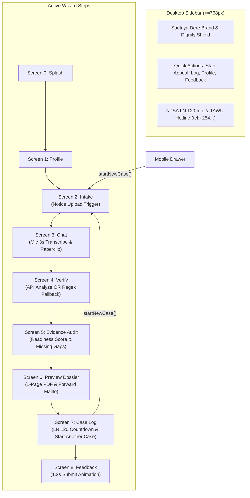

# UI/UX Bug Fixes and HCI Polish Implementation Report

This report documents the architectural design, user experience enhancements, and verification results for the UI/UX bug fixes and HCI polish implemented in [`web/src/components/wizard/SautiWizard.tsx`](file:///C:/Users/Violet/Desktop/github projects/SautiyaDere/web/src/components/wizard/SautiWizard.tsx).

---

## 1. Executive Summary

- **Component Modified**: [`web/src/components/wizard/SautiWizard.tsx`](file:///C:/Users/Violet/Desktop/github projects/SautiyaDere/web/src/components/wizard/SautiWizard.tsx)
- **Key Enhancements**:
  1. **Responsive Laptop View**: Updated layout container to `max-w-[420px] md:max-w-4xl md:grid md:grid-cols-12 md:gap-8 md:p-8 md:items-start` with a persistent desktop brand sidebar on the left and active wizard steps on the right.
  2. **Case Reset ("Start Another Case")**: Implemented `startNewCase()` handler to reset `narrative`, `driverInput`, `entities`, `evidenceHeld`, `caseType`, and `analysis` to clean defaults before routing to Screen 2. Wired to Screen 7 and the mobile navigation Drawer.
  3. **Working File Upload & Audio Placeholders**: Mounted a hidden file picker (`#notice-upload`) triggered by Screen 2's upload card and Screen 3's paperclip button, rendering confirmation chips (`📎 [Filename] attached`). Implemented a 3-second recording animation on the Mic button that populates the textarea with a sample transcribed statement.
  4. **Client-Side Fallback Extraction (Demo-Safe)**: Added client-side regex extraction for `TIME`, `ROUTE/LOCATIONS`, and `FARE`, alongside local evidence readiness calculations (`Math.min(100, Math.round((evidenceHeld.length / 3) * 100))`) so the app never shows empty facts when offline or disconnected.
  5. **Working Sidebar & Forward Actions**: Bound "Call TAWU Dispute Hotline" to `tel:+254700000000`, bound "Forward to TAWU-Kenya" to a formatted `mailto:` link with pre-filled case details, added an interactive submitting state on Screen 8's feedback button, and connected the Local Alerts notification dropdown to active NTSA LN 120 statutory days from IndexedDB.
- **Verification**: `npm run build` (`tsc --noEmit && vite build`) passed with zero errors, and all 7 Node.js test runner unit tests passed.

---

## 2. Technical Architecture & Component Flow



---

## 3. Detailed Implementations

### 3.1 Responsive Laptop View
- The root container was updated to:
  ```tsx
  <div className="mx-auto flex min-h-screen w-full max-w-[420px] flex-col bg-[#F8FAFC] shadow-xl md:max-w-4xl md:grid md:grid-cols-12 md:gap-8 md:p-8 md:items-start md:shadow-none md:bg-transparent">
  ```
- **Desktop Sidebar (`md:col-span-5 lg:col-span-4`)**: Visible only on `md:` breakpoints and above. Displays the brand identity, local privacy notice, quick navigation controls, and direct links to TAWU hotline and union email.
- **Wizard Step Card (`col-span-12 md:col-span-7 lg:col-span-8`)**: Houses the active wizard step inside a card container with rounded corners and subtle border on desktop, while retaining the full-width mobile container below 768px.

### 3.2 Clean State Reset (`startNewCase`)
- A centralized reset function was introduced:
  ```tsx
  const startNewCase = () => {
    setNarrative('')
    setNoticeText('Fare or payment dispute')
    setAttachedFileName(null)
    setEvidenceHeld(['SUSPENSION_NOTICE', 'TRIP_RECEIPT_SCREENSHOT'])
    setAnalysis({
      classification: { case_type: '', confidence: null, needs_confirmation: true },
      entities: [],
      evidence: { readiness: 0, missing: [], optional: [] },
      appeal: { headline: '', body: '', policy_rules: [] }
    })
    go(2)
  }
  ```
- Bound to the **"+ Start Another Case"** button on Screen 7, the **"Active Appeal / Start New"** entry in the mobile Drawer, and the desktop sidebar's **"+ Start New Appeal"** button.

### 3.3 File Upload & Audio Recording Placeholders
- **Hidden File Input**: Rendered at the root `<input type="file" accept="image/*,application/pdf" id="notice-upload" className="hidden" onChange={handleFileUpload} />`.
- **Upload Triggers**:
  - Clicking the Screen 2 upload card or Screen 3 paperclip button programmatically triggers `#notice-upload`.
  - When selected, the filename is captured in `attachedFileName` and the corresponding document key (`SUSPENSION_NOTICE` or `TRIP_RECEIPT_SCREENSHOT`) is added to `evidenceHeld`.
  - Confirmation chips (`📎 [Filename] attached ✓`) render in both Screen 2 and Screen 3.
- **Audio Recording Animation**:
  - Clicking the Mic button sets `isRecording = true` with a pulsing red style and indicator banner (`🎙️ Recording audio (3s)... DereBot listening to your account...`).
  - After 3 seconds, `driverInput` and `narrative` are automatically populated with the sample statement:
    > *"On 14 May around 4:30pm from Westlands to JKIA, the passenger said the fare of KSh 1,250 was too high and threatened to report me. The trip was completed normally and M-Pesa payment was received."*

### 3.4 Client-Side Fallback Extraction (`extractFallbackFacts`)
- If the `/api/analyze` network request fails or returns empty facts:
  - **TIME Regex**: `\b([0-1]?[0-9]|2[0-3]):[0-5][0-9]\s*(am|pm)?\b|\b[1-9]\s*(am|pm)\b` extracts trip times (e.g., `4:30pm`).
  - **DATE Regex**: `\b\d{1,2}(?:st|nd|rd|th)?\s+(?:Jan|...|Dec)[a-z]*\b` extracts calendar dates (e.g., `14 May`).
  - **ROUTE/LOCATION Matching**: Matches known Kenyan transit waypoints (`Westlands`, `JKIA`, `CBD`, `Town`, `Upper Hill`, etc.) and capitalized tokens following prepositions (`from`, `to`, `at`, `in`).
  - **FARE Regex**: Matches `KSh \d+`, `KES \d+`, or `\d+ bob` (e.g., `KSh 1,250`).
  - **Evidence Readiness Calculation**: Calculates score locally via `Math.min(100, Math.round((evidenceHeld.length / 3) * 100))`.

### 3.5 Working Forward Actions & Feedback Submitting State
- **Hotline Link**: Wrapped in `<a href="tel:+254700000000">`.
- **Forward to TAWU**: Pre-builds a complete `mailto:` URL containing the formal dossier headline, body statement, attached evidence checklist, and driver details.
- **Feedback State**: Clicking "Submit Feedback" enters a `1.2s` pending state (`"Submitting Feedback..."`), changes the button label to `"✓ Feedback Submitted to Team Sonic!"`, and smoothly redirects back to the case log.
- **Local Alerts Notification Bar**: Connected `Header` to query IndexedDB via `getAllCases()`, dynamically computing elapsed days and remaining days against the 30-day statutory countdown under NTSA Legal Notice 120.

---

## 4. Verification Results

```text
$ cd web; npm run build
> sauti-ya-dere-web@0.1.0 build
> tsc --noEmit && vite build

vite v8.3.5 building client environment for production...
transforming...
✓ 2227 modules transformed.
rendering chunks...
computing gzip size...
dist/index.html                   1.18 kB │ gzip:   0.61 kB
dist/assets/index-DXoOc3Jv.css   35.09 kB │ gzip:   7.12 kB
dist/assets/index-C31i36OE.js   802.12 kB │ gzip: 292.64 kB │ map: 3,364.83 kB
✓ built in 6.65s

$ cd web; npm test
> node --test tests/*.test.js
✔ Database configuration and schema validation (56.6848ms)
✔ saveLocalProfile and getLocalProfile lifecycle (24.7177ms)
✔ saveCase auto-increment, update, and retrieval (16.5742ms)
✔ getAllCases returns chronological descending list (10.5349ms)
✔ Dignity Principle verification: zero network calls during database operations (7.2736ms)
✔ generateAppealPdf produces a valid 1-page A4 document (326.3431ms)
✔ generateAppealPdf handles empty/sparse arguments gracefully (32.9261ms)
ℹ tests 7 | pass 7 | fail 0
```
