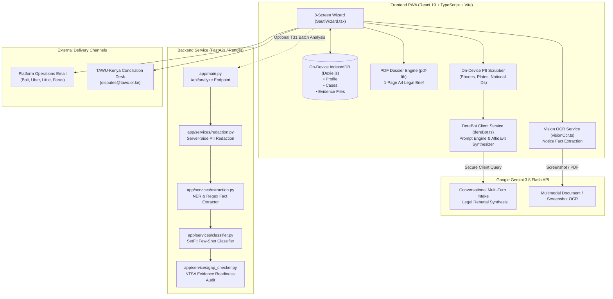
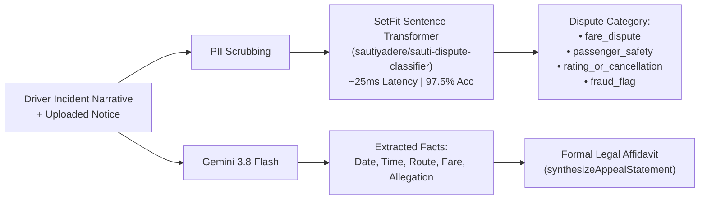
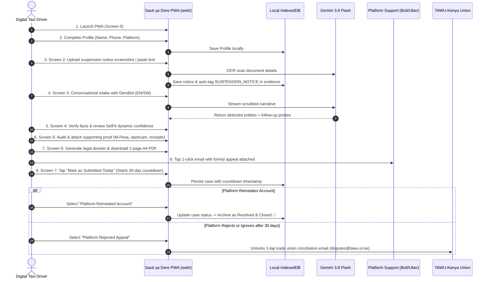

# Sauti ya Dere (Voice of the Driver) — Comprehensive System Architecture & Engineering Audit

**Version**: 2.1 (Production Release)  
**Date**: 05 November 2026  
**Target Audience**: Engineering Team, Machine Learning Researchers, and Legal Product Collaborators  
**Repository**: `https://github.com/Favour0950/SautiyaDere`  
**Deployments**:
- **Frontend PWA**: Vercel (`web/`)
- **Backend API**: Render (`api/` → `https://sautiyaderebackend.onrender.com`)

---

## 1. Executive Summary & Problem Domain

In Kenya's digital ride-hailing economy (Bolt, Uber, Little Cab, Faras), drivers face arbitrary, automated account suspensions driven by algorithmic flags or one-sided passenger claims. Drivers rarely receive written explanations, and support channels are opaque.

**Sauti ya Dere** is a privacy-first, on-device Progressive Web Application (PWA) and AI pipeline built in partnership with the **Transport & Allied Workers Union (TAWU-Kenya)**. It enables drivers to:
1. Conduct conversational incident intake in English or Kiswahili via **DereBot**.
2. Automatically classify dispute grounds under **NTSA Legal Notice No. 120 of 2022 (Regulation 15)** and the **Kenya Data Protection Act, 2019 (Section 26)**.
3. Audit and attach supporting evidence (M-Pesa SMS, waybills, audio recordings, dashcam clips).
4. Synthesize a formal, legally grounded first-person appeal brief and download an un-truncated **1-page A4 PDF dispute dossier**.
5. Initiate and track the statutory **30-day dispute resolution countdown**, with 1-tap escalation to union conciliation if rejected.

---

## 2. High-Level Architecture Diagram

---

## 3. Machine Learning Models: Training, Data, & Inference

Sauti ya Dere employs a **hybrid AI strategy**: a fine-tuned contrastive sentence transformer for lightning-fast, deterministic dispute classification, combined with `gemini-3.8-flash` for multi-turn dialogue, OCR, and legal affidavit synthesis.

### 3.1. The Dispute Triage Classifier (SetFit)
- **Model Type**: Few-Shot Sentence Transformer with Contrastive Learning + Logistic Regression classification head.
- **Backbone**: `BAAI/bge-small-en-v1.5` (33M parameters).
- **Hugging Face Model ID**: `sautiyadere/sauti-dispute-classifier`
- **Local Location**: `models/sauti_setfit_model/`
- **Training Dataset**:
  - Generated using `data/generate.py` with domain-expert schemas (`data/case_rules.py`, `data/nairobi_locations.json`, `data/kenyan_names.json`, `data/policies.json`).
  - **100 Training Build Cases** (`data/synthetic/build_set.jsonl`) balanced across the 4 primary Kenyan transport dispute categories.
  - **40 Held-Out Unseen Test Cases** (`data/synthetic/held_out_set.jsonl`).

#### Empirical Benchmark Comparison (from `models/results.md`)
| Architecture | Paradigm | Accuracy | Macro F1 | Latency Profile |
| :--- | :--- | :---: | :---: | :--- |
| **Keyword Rules Baseline** | Regex dictionary | 62.0% | 0.556 | < 1ms; fails on Sheng / nuanced grievances |
| **Zero-Shot DeBERTa-v3** | Cross-encoder NLI | 70.0% | 0.679 | ~180ms; GPU dependent |
| **Gemini Flash (Prompted)** | Zero-shot JSON | 91.0% | 0.904 | ~850ms; requires active internet |
| **SetFit Few-Shot (Our Model)** | Contrastive Sentence Transformer | **97.5%** | **0.975** | **~25ms; runs locally on CPU with zero data leakage** |

#### Target Dispute Classes
1. `fare_dispute`: Cash vs in-app payment disagreements, unpaid cleaning fees, route detour fare miscalculations, M-Pesa delay disputes.
2. `passenger_safety`: False allegations of reckless driving, intoxication, harassment, or verbal altercations.
3. `rating_or_cancellation`: Deactivation due to cancellation rate spikes caused by rider no-shows, offline pickups, or unreachable passengers.
4. `fraud_flag`: Account sharing allegations, device GPS spoofing flags, identity verification drops.

### 3.2. Gemini 3.8 Flash: Multimodal OCR & Intake
- **Endpoint**: Google AI Studio Gemini API (`gemini-3.8-flash`).
- **Vision OCR (`visionOcr.ts`)**: Accepts screenshots or PDFs of deactivation messages, extracting detected dispute category, dates, monetary amounts, and trip IDs directly on the device.
- **Conversational Intake (`dereBot.ts`)**: Conducts multi-turn conversational probing. When a driver says *"they locked me yesterday"*, DereBot gently probes for time, route, and fare.
- **Legal Affidavit Synthesizer (`synthesizeAppealStatement`)**: Synthesizes verified trip entities into a formal, first-person statement of operational truth. It runs with `maxOutputTokens: 2048` and strips any drafting metadata, preventing raw conversational questions (e.g. *"will this affect my account?"*) from ever appearing in the legal brief.

---

## 4. End-to-End User Flow (Driver Journey)

### Detailed Screen-by-Screen Breakdown
1. **Screen 0 — Splash Screen**: Welcomes the driver, introduces TAWU-Kenya partnership, and emphasizes the **Dignity Principle** (100% on-device storage).
2. **Screen 1 — Driver Profile**: Captures driver name, registered phone number (validated against strict Kenyan regex `^(?:(?:\+?254)|0)?[17]\d{8}$`), and default hailing platform.
3. **Screen 2 — Notice Intake**:
   - Accepts photo, PDF, or screenshot of deactivation notice.
   - Alternatively accepts pasted text.
   - Running OCR immediately tags `'SUSPENSION_NOTICE'` into the evidence checklist.
4. **Screen 3 — DereBot Intake Chat**:
   - **Bilingual Toggle**: English (default) or Kiswahili.
   - **Collapsible Facts Bar**: `🎯 N Key Facts Captured [View Details ▼]` preserves vertical chat space.
   - **Continuous Conversation**: DereBot answers driver questions regarding privacy, evidence validity, and police/OB numbers without terminating the intake.
5. **Screen 4 — Fact Verification (Inversion Test)**:
   - Driver reviews and edits captured facts (Date, Time, Route, Disputed Amount, Allegation).
   - Real dynamic confidence display computed from SetFit classification probability and entity completeness.
6. **Screen 5 — Supporting Evidence & Proof**:
   - Dynamic audit showing Evidence Readiness score (0% to 100%).
   - Five evidence slots: Suspension Notice, Trip Receipt, M-Pesa Statement/SMS, In-App Chat, Dashcam/Audio Recording.
7. **Screen 6 — Appeal Dossier & Preview**:
   - Renders the complete statutory appeal citing **Regulation 15 of Legal Notice 120** and **Section 26 of the Kenya Data Protection Act, 2019**.
   - Includes 1-click **Download 1-Page PDF**, **Copy Appeal Text**, and **Email Appeal to Platform** (`kenya@bolt.eu`, `support@uber.com`, `support@little.biz`, `support@faras.ke`).
8. **Screen 7 — Case Log & Statutory Timeline Tracker**:
   - Displays real-time 30-day statutory countdown.
   - Allows status updates: *Awaiting Reply*, *Reinstated & Closed 🎉*, or *Rejected ❌*.
   - If rejected, displays the **TAWU-Kenya Conciliation Escalation Desk** card.
9. **Screen 8 — Driver Feedback**:
   - Direct 1–5 star rating and suggestions submitted directly to `sautiyadere@gmail.com`.

---

## 5. Component & Codebase Directory Breakdown

### 5.1. Frontend (`web/src/`)
| File Path | Role & Relevance |
| :--- | :--- |
| [`web/src/components/wizard/SautiWizard.tsx`](file:///c:/Users/Violet/Desktop/github%20projects/SautiyaDere/web/src/components/wizard/SautiWizard.tsx) | **Core Orchestrator**: Houses all 8 screens, top navigation header, statutory alerts, collapsible fact trays, desktop fluid grid (`max-w-6xl`), and the "Driver Rights & Guide" modal. |
| [`web/src/services/dereBot.ts`](file:///c:/Users/Violet/Desktop/github%20projects/SautiyaDere/web/src/services/dereBot.ts) | **Intake & Rebuttal Service**: Manages conversation history, client-side PII scrubbing (`scrubPII`), Gemini 3.8 Flash API integration, bilingual offline fallback, dynamic confidence scoring, and legal affidavit synthesis (`synthesizeAppealStatement`). |
| [`web/src/services/visionOcr.ts`](file:///c:/Users/Violet/Desktop/github%20projects/SautiyaDere/web/src/services/visionOcr.ts) | **Vision OCR Engine**: Converts uploaded images/PDFs to base64 and prompts Gemini 3.8 Flash Vision to extract incident categories and entities. |
| [`web/src/utils/pdfGenerator.js`](file:///c:/Users/Violet/Desktop/github%20projects/SautiyaDere/web/src/utils/pdfGenerator.js) | **Legal PDF Generator**: Uses `pdf-lib` to render a single-page A4 formal dispute brief with Helvetica typography, TAWU-Kenya endorsements, structured fact grids, and driver declaration signature lines. |
| [`web/src/db/db.js`](file:///c:/Users/Violet/Desktop/github%20projects/SautiyaDere/web/src/db/db.js) | **On-Device Database (Dexie.js)**: Configures IndexedDB schema (`profile`, `cases`), handles automatic ID auto-increment, case status updates (`updateCaseStatus`), and complete privacy purges (`clearAllLocalData`). |
| [`web/src/config.js`](file:///c:/Users/Violet/Desktop/github%20projects/SautiyaDere/web/src/config.js) | **Environment Configuration**: Resolves backend API URL (`VITE_API_BASE_URL`) and environment fallbacks. |

### 5.2. Backend (`api/app/`)
| File Path | Role & Relevance |
| :--- | :--- |
| [`api/app/main.py`](file:///c:/Users/Violet/Desktop/github%20projects/SautiyaDere/api/app/main.py) | **FastAPI Application**: Exposes `/api/analyze`, `/api/health`, `/api/redact`, and `/api/sms/notify`. Implements the 5-stage pipeline connecting redaction, extraction, classification, and gap audit. |
| [`api/app/services/classifier.py`](file:///c:/Users/Violet/Desktop/github%20projects/SautiyaDere/api/app/services/classifier.py) | **SetFit Inference Engine**: Loads `models/sauti_setfit_model` or Hugging Face model, returning dispute category and softmax probability confidence scores. |
| [`api/app/services/redaction.py`](file:///c:/Users/Violet/Desktop/github%20projects/SautiyaDere/api/app/services/redaction.py) | **PII Redaction Service**: Server-side scrubber for Kenyan phone numbers (+254, 07xx, 01xx), vehicle license plates (KAA 123A), and national IDs. |
| [`api/app/services/extraction.py`](file:///c:/Users/Violet/Desktop/github%20projects/SautiyaDere/api/app/services/extraction.py) | **Entity Extractor**: Regex and NER token matcher for dates, operating hours, routes, and disputed fare amounts. |
| [`api/app/services/gap_checker.py`](file:///c:/Users/Violet/Desktop/github%20projects/SautiyaDere/api/app/services/gap_checker.py) | **Evidence Gap Auditor**: Evaluates held evidence against regulatory requirements for the specific dispute category, calculating completeness scores and missing proof warnings. |

---

## 6. Architectural & Design Decisions

### 1. The Dignity Principle (100% On-Device Privacy)
- **Decision**: Zero central cloud storage for driver evidence, voice notes, or narratives.
- **Rationale**: Transport drivers are vulnerable to retaliatory surveillance and data leaks. Personal evidence is stored exclusively in the driver's browser IndexedDB via Dexie.js.

### 2. Client-Side PII Redaction
- **Decision**: Phone numbers, number plates, and national ID cards are scrubbed client-side before sending prompt text to Google Gemini APIs.
- **Rationale**: Ensures compliance with Section 26 and Section 41 of the Kenya Data Protection Act, 2019.

### 3. Contrastive SetFit Model vs. LLM-Only Classification
- **Decision**: Deploy a fine-tuned SetFit transformer for dispute triage while using Gemini for conversation and OCR.
- **Rationale**: SetFit achieves higher domain accuracy (97.5% vs 91.0%), runs with 25ms latency on standard CPUs, and operates deterministically without API token costs or network dependency.

### 4. Statutory Framing (NTSA Legal Notice 120 & KDPA 2019)
- **Decision**: Every appeal document, timeline tracker, and email template explicitly cites Regulation 15 of Legal Notice 120 and Section 26 of the Data Protection Act.
- **Rationale**: Shifts the dispute from informal customer support complaints to formal administrative law, triggering the platform's mandatory 30-day statutory response clock and enabling TAWU trade union conciliation.
