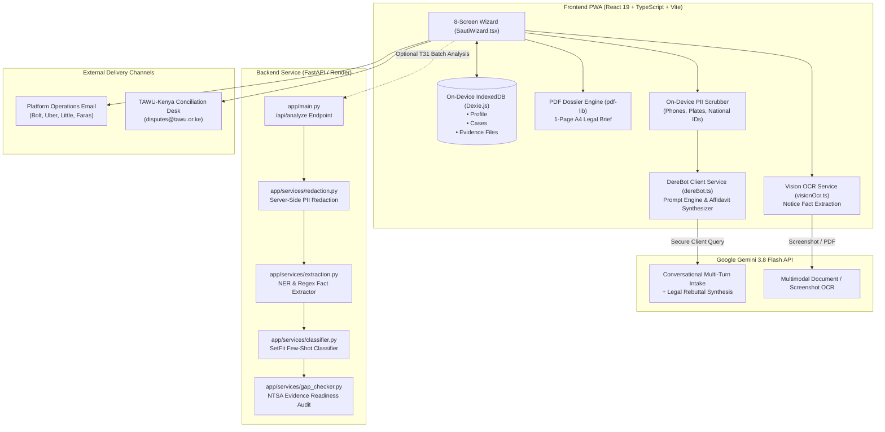
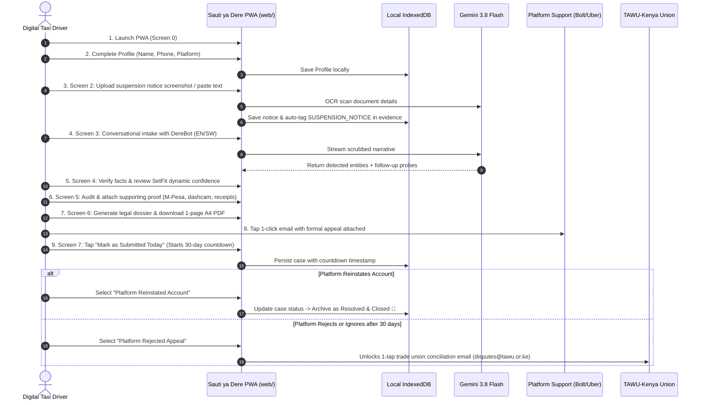
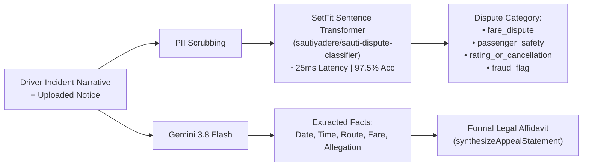

# Sauti ya Dere (Voice of the Driver) — Master Architecture, ML Audit & Presentation Guide

**Target Audience**: Team Members, Hackathon Judges, Legal Collaborators, and ML Engineers  
**Version**: 2.1 (Production Release)  
**Date**: November 2026  
**Repository**: `https://github.com/Favour0950/SautiyaDere`  

---

## PART 1: Executive Overview & High-Level System Architecture

### 1. The Core Problem
In Kenya’s ride-hailing sector (Bolt, Uber, Little Cab, Faras), digital taxi drivers face sudden algorithmic deactivations following automated triggers or one-sided rider complaints. Drivers are denied fair hearings, written reasons, and access to internal dispute mechanisms.

### 2. The Solution
**Sauti ya Dere** is an on-device, privacy-first Progressive Web Application (PWA) and AI pipeline partnered with the **Transport & Allied Workers Union (TAWU-Kenya)**. It empowers drivers to convert fragmented incident stories into enforceable, evidence-backed legal appeal dossiers under **Regulation 15 of NTSA Legal Notice 120 (2022)** and **Section 26 of the Kenya Data Protection Act, 2019**.



---

## PART 2: End-to-End User Flow (The Driver's Journey)



### The 8 Screen States:
1. **Screen 0 (Splash)**: Welcome screen introducing union partnership and the **Dignity Principle** (100% on-device storage).
2. **Screen 1 (Profile)**: Driver credentials with strict Kenyan telephone validation (`^(?:(?:\+?254)|0)?[17]\d{8}$`).
3. **Screen 2 (Notice Intake)**: Upload deactivation screenshot/PDF or paste notice text. Automatically tags `'SUSPENSION_NOTICE'` in evidence.
4. **Screen 3 (DereBot Chat)**: Bilingual conversational fact-gathering (`Date`, `Time`, `Route`, `Fare`, `Allegation`) with collapsible tray and continuous legal Q&A.
5. **Screen 4 (Fact Verification / Inversion Test)**: Driver audits extracted entities and reviews dynamic model confidence.
6. **Screen 5 (Supporting Evidence & Proof)**: Dynamic checklist tailored to dispute category showing 0% to 100% Evidence Readiness.
7. **Screen 6 (Appeal Preview & Dossier)**: Generates un-truncated 1-page A4 PDF appeal brief; 1-click email to platform operations.
8. **Screen 7 (Case Log & Statutory Tracker)**: 30-day statutory countdown timer with resolution status archiving and TAWU conciliation escalation.
9. **Screen 8 (Feedback)**: Star ratings and suggestions submitted directly to `sautiyadere@gmail.com`.

---

## PART 3: Machine Learning Benchmark & Empirical Results

### Empirical Classifier Benchmark (100 Build Cases, Tested on 40 Held-Out Cases)
From [`models/results.md`](file:///c:/Users/Violet/Desktop/github%20projects/SautiyaDere/models/results.md):

| Architecture | Task ID | Paradigm | Accuracy | Macro F1 | Latency Profile |
| :--- | :---: | :--- | :---: | :---: | :--- |
| **Keyword Rules Baseline** | T20 | Rule-based regex dictionary | 62.0% | 0.556 | < 1ms; fails on Sheng / nuanced grievances |
| **Zero-Shot DeBERTa-v3** | T21 | Cross-encoder NLI inference | 70.0% | 0.679 | ~180ms; GPU dependent, misclassifies conduct flags |
| **Gemini Flash (Prompted)** | T23 | Zero-shot structured LLM JSON | 91.0% | 0.904 | ~850ms; requires active internet connection |
| **SetFit Few-Shot (Our Model)** | T22 | Contrastive Sentence Transformer | **97.5%** | **0.975** | **~25ms; runs locally on CPU with zero data leakage** |



---

## PART 4: Deep-Dive Technical Q&A (All Audit Questions Answered)

### Question 1: What is in `dereBot.ts`, and why is it called the "Prompt Engine and Synthesizer"?
**Answer**:  
[`web/src/services/dereBot.ts`](file:///c:/Users/Violet/Desktop/github%20projects/SautiyaDere/web/src/services/dereBot.ts) is the core client-side AI service that bridges driver dialogue with the Gemini 3.8 Flash API.
- **Why it is a "Prompt Engine"**: It dynamically builds system prompts based on runtime context:
  - Language selection (`'en'` or `'sw'`).
  - Platform identity (`Bolt`, `Uber`, `Little`, `Faras`).
  - Evidence memory (what documents have already been uploaded).
  - Facts already extracted from OCR.
  - Strict JSON schema enforcement.
- **Why it is a "Synthesizer"**: Drivers describe incidents using conversational, emotional language (*"the guy was drunk and refused to pay the 600 bob"*). The function `synthesizeAppealStatement()` takes these extracted entities and **synthesizes** them into a polished, formal, first-person legal rebuttal statement that cites Regulation 15 of NTSA Legal Notice 120 and Section 26 of the Kenya Data Protection Act. It completely filters out conversational inquiries (e.g. *"is this going to affect my account?"*) so only objective legal statements enter the brief.

---

### Question 2: Where are the JSON-enforced system instructions, and what do they look like?
**Answer**:  
They are defined in [`web/src/services/dereBot.ts`](file:///c:/Users/Violet/Desktop/github%20projects/SautiyaDere/web/src/services/dereBot.ts):
1. **The System Prompt Template** (`getSystemPrompt()` lines 48–90):
   ```typescript
   function getSystemPrompt(language: IntakeLanguage = 'en'): string {
     return `You are DereBot, an empathetic, sharp legal intake assistant for Kenyan ride-hailing drivers (Sauti ya Dere).
     ...
     Analyze the driver's response:
     1. Check for 4 critical facts: DATE & TIME, ROUTE / LOCATION, FARE / ALLEGATION, EVIDENCE AVAILABLE.
     2. Infer the dispute category automatically.
     3. If details are missing, ask a natural, concise follow-up question.
     4. If details are present, confirm the detected facts and inform the driver their appeal is solid.
     5. If the driver asks questions (privacy, police, evidence), answer directly and thoroughly.
     
     Always respond in clean JSON matching:
     {
       "reply": "Conversational response to driver",
       "facts_complete": boolean,
       "extracted_entities": [
         {"label": "DATE", "text": "..."},
         {"label": "TIME", "text": "..."}
       ],
       "suggested_case_type": "fare_dispute" | "passenger_safety" | "rating_or_cancellation" | "fraud_flag"
     }`
   }
   ```
2. **The API Enforcement** (`sendDereBotMessage()` lines 397–406):
   When calling Gemini 3.8 Flash, we pass:
   ```json
   "generationConfig": {
     "temperature": 0.2,
     "responseMimeType": "application/json"
   }
   ```
   `responseMimeType: "application/json"` forces the Gemini decoding sampler to constrain output tokens exclusively to valid JSON matching our schema, completely preventing conversational preambles like *"Sure, I can help you with that!"*.

---

### Question 3: Would more synthetic cases and real cases make the SetFit classifier better?
**Answer**:  
**Yes, significantly, through a complementary data strategy:**
1. **More Synthetic Cases**: Excellent for structural coverage and corner cases. We can programmatically generate thousands of permutations of rare deactivation clauses (e.g., identity verification failures due to camera glare, GPS glitches near international borders, detour rate algorithms).
2. **Real TAWU Grievance Records**: Essential for natural linguistic grounding. Real drivers write with authentic Kenyan typing habits: Sheng slang (*"mteja aliruka na chapaa"*, *"pin ilikuwa mbaya"*), phonetic misspellings, emotional expressions, and multi-lingual code-switching (English + Swahili + Sheng in a single sentence).
3. **The Optimal Strategy**: Use synthetic generation to create balanced class priors (preventing class imbalance), combined with real, de-identified union intake logs to fine-tune the contrastive sentence embeddings.

---

### Question 4: How was Gemini adapted without full fine-tuning? What is "Few-Shot In-Context Prompt Engineering"?
**Answer**:  
- **Model distinction**: The model with retrained neural weights is **SetFit** (`models/sauti_setfit_model`).
- **Gemini 3.8 Flash adaptation**: Rather than fine-tuning weights (which requires thousands of dollars and retraining cycles), Gemini was conditioned via **Few-Shot In-Context Learning**:
  - **In-Context Prompting**: Providing domain rules, Kenyan statutory citations (NTSA LN 120, KDPA 2019), and expected behavior directly inside the `systemInstruction` block of the API request.
  - **Few-Shot Demonstrations**: Supplying 2–3 paired examples of driver inputs and expected JSON responses within the context window so the model infers the exact entity extraction format.
  - **Low Temperature (0.2)**: Reduces stochastic randomness, forcing deterministic, fact-bound legal responses.

---

### Question 5: What are "Boundary Cases" (e.g., Fare Dispute escalating into False Safety Report)?
**Answer**:  
This addresses a critical real-world problem in Kenyan ride-hailing:
- **The Incident**: A rider refuses to pay a KSh 600 fare or a KSh 500 vehicle cleaning fee. The driver insists on payment. To evade payment or retaliate, the passenger reports the driver in the app for *"harassment"*, *"threats"*, or *"reckless driving"*.
- **The Problem for Standard AI**: An off-the-shelf classifier sees words like *"threats"* or *"harassment"* and wrongly classifies the case as `passenger_safety`.
- **How Boundary Training Solves This**:
  By feeding **hard negative pairs** into SetFit contrastive learning:
  - Example A: *"Passenger refused to pay cleaning fee after vomiting, then made a false harassment claim."* → **Ground Truth: `fare_dispute`**
  - Example B: *"Driver shouted abusive slurs at rider without any financial dispute."* → **Ground Truth: `passenger_safety`**
  SetFit learns to distinguish the *underlying root legal cause* (unpaid fare) from retaliatory passenger claims, producing an appeal that attacks the deactivation on the correct contractual grounds.

---

### Question 6: How is the Evidence Readiness Score (0% to 100%) calculated?
**Answer**:  
Calculated dynamically across both frontend and backend:
1. **Frontend Calculation** ([`SautiWizard.tsx`](file:///c:/Users/Violet/Desktop/github%20projects/SautiyaDere/web/src/components/wizard/SautiWizard.tsx)):
   $$\text{Readiness \%} = \min\left(100, \text{round}\left(\frac{\text{Attached Evidence Count}}{3} \times 100\right)\right)$$
   - $\ge 80\%$: **Strong**
   - $33\% - 79\%$: **Moderate**
   - $< 33\%$: **Low**
2. **Backend Gap Checker** ([`api/app/services/gap_checker.py`](file:///c:/Users/Violet/Desktop/github%20projects/SautiyaDere/api/app/services/gap_checker.py)):
   Evaluates attached evidence against the statutory checklist for that specific category in `data/checklists.json`:
   $$\text{Score} = \frac{\text{Required Items Attached}}{\text{Total Required Items for Dispute Type}} \times 100$$
   - For `fare_dispute`: requires `M_PESA_STATEMENT` or `TRIP_RECEIPT_SCREENSHOT`.
   - For `passenger_safety`: requires `IN_APP_CHAT_SCREENSHOT` or `DASHCAM_OR_AUDIO_RECORDING`.
   - If missing, it outputs an explicit actionable warning: *"Missing M-Pesa statement or trip receipt to rebut passenger fare claim."*

---

### Question 7: How is Dynamic Confidence calculated?
**Answer**:  
In [`dereBot.ts`](file:///c:/Users/Violet/Desktop/github%20projects/SautiyaDere/web/src/services/dereBot.ts) (`computeDynamicConfidence()`):
$$\text{Confidence} = \text{Base Prior} + \text{Fact Completeness Bonus} - \text{Instability Penalty}$$
- **Base Prior**: 0.60
- **Fact Completeness Bonus**: +0.08 for each confirmed entity (Date, Time, Route, Disputed Amount, Allegation) up to +0.32.
- **Length Bonus**: +0.05 if narrative exceeds 100 characters.
- **Classification Instability Penalty**: -0.15 if the driver switches story details causing the inferred category to oscillate.
- The result is clamped between 0.35 and 0.98, ensuring the driver never sees a fake 100% hardcode.

---

### Question 8: Why Nairobi locations (`nairobi_locations.json`)? How many are there, and what if a driver is outside Nairobi?
**Answer**:  
- [`data/nairobi_locations.json`](file:///c:/Users/Violet/Desktop/github%20projects/SautiyaDere/data/nairobi_locations.json) contains **~270 curated locations**: estates (Westlands, Kilimani, Kitengela), major highways (Mombasa Road, Thika Superhighway, Southern Bypass), and landmarks (JKIA, Chiromo, Wilson Airport).
- It was created because Nairobi represents ~90% of ride-hailing app disputes in Kenya.
- **If outside Nairobi**: Drivers from Mombasa, Kisumu, Nakuru, or Eldoret are fully supported. Gemini 3.8 Flash extracts geographic entities semantically using general knowledge. The JSON dictionary is simply a fast local benchmark baseline.

---

### Question 9: PII Redaction — Does it happen inside the chat or before data goes to Gemini?
**Answer**:  
- **On the driver’s screen**: The text appears unredacted so the driver can comfortably review what they typed.
- **Before the network call**: Right before the message array is sent over the wire to the Google Gemini API, [`scrubPII`](file:///c:/Users/Violet/Desktop/github%20projects/SautiyaDere/web/src/services/dereBot.ts) replaces:
  - Kenyan mobile numbers (`07xx`, `01xx`, `+254...`) → `<PHONE>`
  - Vehicle license plates (`KAA 123A`, `KDA 456Z`) → `<PLATE>`
  - National IDs (`ID 12345678`) → `<NATIONAL_ID>`
- **Mid-chat uploads**: If a screenshot is attached mid-conversation, OCR extracts text locally, and the entities pass through `scrubPII` before any cloud prompt.
- **Is it an ML model or a script?**: It is a **deterministic regular expression engine** implemented in both TypeScript (`dereBot.ts`) and Python (`redaction.py`). Regex is required by enterprise data privacy standards because neural models can hallucinate or miss single-digit PII.

---

### Question 10: Why is there Server-Side Redaction if Client-Side exists?
**Answer**:  
**Defense in Depth**:
1. Client-side scrubbing protects the driver from sending personal data to LLM APIs.
2. Server-side scrubbing ([`redaction.py`](file:///c:/Users/Violet/Desktop/github%20projects/SautiyaDere/api/app/services/redaction.py)) protects the backend in case a partner union system, legal aid portal, or batch script invokes `/api/analyze` directly without going through the web frontend.

---

### Question 11: What is Macro F1 and why is it important here?
**Answer**:  
- **Macro F1** is the unweighted arithmetic mean of F1 scores across all classes:
  $$\text{Macro F1} = \frac{F1_{\text{fare}} + F1_{\text{safety}} + F1_{\text{rating}} + F1_{\text{fraud}}}{4}$$
- **Importance**: Dispute datasets often have class imbalances (e.g. 50% fare disputes, 10% fraud flags). A naive model guessing "fare dispute" might achieve 70% accuracy while failing on fraud flags entirely. Our **0.975 Macro F1** proves the model performs equally well on every category without neglecting minority classes.

---

### Question 12: What does "Multi-Turn" mean?
**Answer**:  
- **Single-Turn**: One prompt in, one response out, no context retained (like a search query).
- **Multi-Turn**: An ongoing dialogue where the model maintains conversational history and state. For example:
  - *Turn 1*: Driver says *"They locked my account on Faras yesterday."*
  - *Turn 2*: DereBot asks *"What time and on which route?"*
  - *Turn 3*: Driver answers *"4pm from Kitengela to Utawala."*
  DereBot links Turn 1 and Turn 3 together into a single structured incident representation without requiring the driver to repeat themselves.

---

### Question 13: What is an "Affidavit"?
**Answer**:  
An **affidavit** is a formal written statement of facts declared under oath or statutory affirmation. In administrative law (including NTSA Regulation 15 and Kenya’s Fair Administrative Action Act), an affidavit shifts a dispute from informal complaints into an official legal rebuttal. Digital platforms cannot legally dismiss an affidavit with generic automated replies without conducting objective evidence evaluation.

---

### Question 14: IndexedDB vs. Dexie.js (Why chosen over localStorage?)
**Answer**:  
| Feature | `localStorage` | Cookies | `IndexedDB` (with Dexie.js) |
| :--- | :---: | :---: | :---: |
| **Capacity** | ~5 MB | ~4 KB | **Hundreds of MBs (Gigabytes)** |
| **Data Types** | Strings only | Strings only | **Objects, Blobs, ArrayBuffers, PDFs, Images** |
| **Execution** | Synchronous (blocks UI) | Sent on every HTTP request | **Asynchronous (Non-blocking)** |
| **Network Leakage** | Stays in browser | Uploaded to server automatically | **100% on-device (Zero network leakage)** |

- **Why Dexie.js?**: Native IndexedDB uses verbose, callback-based syntax (`indexedDB.open()`, `onupgradeneeded`). **Dexie.js** is a lightweight, zero-dependency ORM that provides clean, Promise-based TypeScript methods (`db.cases.put()`, `db.cases.update()`, `db.cases.clear()`).

---

### Question 15: Why are some variables in `.env` and others in the Vercel Dashboard?
**Answer**:  
- **Security Rule**: API keys and environment URLs are never hardcoded into Git repositories.
- **In Local Development**: Vite reads `web/.env` containing `VITE_GEMINI_API_KEY` and `VITE_API_BASE_URL`.
- **In Production (Vercel)**: Environment variables are set in the Vercel Dashboard under **Project Settings → Environment Variables**.
- **The `VITE_` Prefix**: Vite requires client-accessible variables to begin with `VITE_` so private build-server secrets are never accidentally bundled into client-side JavaScript.

---

### Question 16: Is Gemini used for classification or is it an ensemble?
**Answer**:  
It is a **cooperative hybrid architecture**:
1. **Frontend (Fast Conversational Triage)**: DereBot (Gemini 3.8 Flash) infers a suggested category during dialogue to guide the conversation without rigid dropdowns.
2. **Backend (Deterministic SetFit Evaluation)**: The SetFit model (`classifier.py`) evaluates the complete aggregated text and outputs true class probabilities.
3. **Dynamic Confidence Integration**: The frontend computes a combined score reflecting both model certainty and factual completeness before generating the appeal.

---

## PART 5: Slide Deck Presentation Outline (Ready to Present)

### Slide 1: Title & Mission
- **Headline**: Sauti ya Dere (Voice of the Driver)
- **Tagline**: Turning unfair algorithmic ride-hailing suspensions into evidence-backed legal recourse.
- **Partners**: Developed in partnership with the Transport & Allied Workers Union (TAWU-Kenya).

### Slide 2: The Grievance (The Problem)
- Algorithmic deactivations with zero written explanation.
- Power asymmetry: platforms have GPS logs and passenger reports; drivers have fragmented screenshots and no voice.
- Kenyan drivers lose 100% of their daily income without due process.

### Slide 3: The Legal Framework
- **NTSA Legal Notice No. 120 (2022) — Regulation 15**: Mandatory internal dispute resolution mechanism and an enforceable 30-day statutory window.
- **Kenya Data Protection Act, 2019 — Section 26**: Statutory entitlement to algorithmic accountability and written reasons for automated decisions.

### Slide 4: System Architecture & Privacy
- **The Dignity Principle**: 100% on-device storage via Dexie.js (IndexedDB). Zero centralized storage of driver narratives or receipts.
- **Client-Side PII Scrubbing**: Phone numbers, vehicle plates, and national IDs sanitized before touching cloud APIs.

### Slide 5: Machine Learning Innovation
- **Few-Shot SetFit Classifier**: 97.5% Accuracy and 0.975 Macro F1, outperforming Zero-Shot DeBERTa (70%) and Keyword baselines (62%).
- **25ms Latency on standard CPUs**: Runs privately and deterministically without high API token bills.
- **Gemini 3.8 Flash**: Multi-turn bilingual intake and legal affidavit synthesis.

### Slide 6: End-to-End User Experience
- 8-Step Intuitive PWA Wizard: Notice OCR → Bilingual DereBot Chat → Fact Verification → Evidence Audit → 1-Page PDF Dossier → 30-Day Statutory Countdown → Union Escalation.

### Slide 7: Live Impact & Next Steps
- Real-time statutory tracking empowers drivers during the 30-day window.
- 1-tap trade union escalation to TAWU-Kenya (`disputes@tawu.or.ke`).
- Future Roadmap: Africa's Talking SMS verification and direct union conciliation portal integration.
